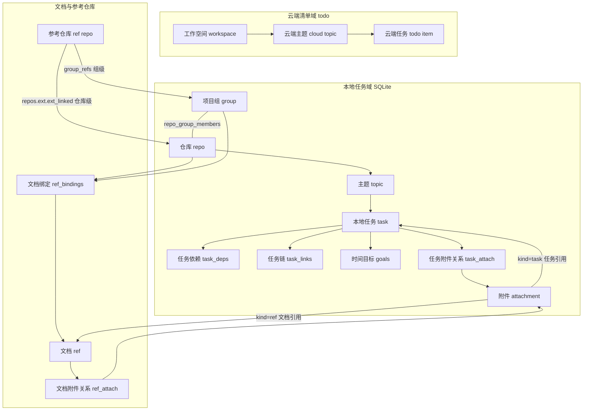

# nx-kv 术语与概念规范

> **本文件是 nx-kv 的唯一权威词表。** 代码注释、skill 文档、Web 文案与本文冲突时，以本文为准；本文与 schema / 代码冲突时，以 schema / 代码为准并修正本文。
>
> 事实来源：`src/core/db/migrations/v1.sql` ~ `v4.sql`（当前 schema **v4**）、`src/modules/**`、`src/shared/prompt-blocks.js`、`src/web/frontend/**`。
> 版本基线：schema v4；CLI 0.34.0。
> 维护方式：本文件是**编辑源**；发布到 nx-kv 自己的文档库（`refs`）是发布动作，命令见文末「发布约定」。

---

## 1. 概念层级



文字版从属关系：

- **工作空间** 隔离云端清单；一个工作空间下有多个 **云端主题**，一个云端主题下有多条 **云端任务**。
- **项目组** 与 **仓库** 是多对多（`repo_group_members`）；仓库是文档、主题归属的主体。
- **主题** 属于一个 **仓库**（`topics.repo_key` 必填），可选归属一个 **项目组**（`topics.group_key`）。
- **本地任务** 属于一个主题；主题内用 `seq` 编号，全局用 `tasks.id` 标识。
- **参考仓库** 不是独立实体，而是 `repos` 中「参考身份」的行；可绑到项目组，也可直接绑到仓库。
- **文档** 是 `refs` + docs 目录里的 `.md`；可被仓库/项目组/组内仓库绑定，也可作为附件被任务或文档引用。
- **附件** 是统一资源行，按 `kind` 分 file / url / task / ref，按 `role` 决定出现在正文还是附件区。
- **看板** 是「项目组」的历史别名；「目录看板」是 Web 面板里的目录视图，不是实体。

---

## 2. 词表

### 2.1 本地任务域

| # | 规范名 | 代码标识（表 / 字段 / 函数） | 定义 | 判定依据 | 常见误用 |
|---|--------|------------------------------|------|----------|----------|
| N01 | **主题**（topic，本地队列） | `topics`；`topics.key`；`topic_key`；`topicKeyOf()` | 本地任务队列容器。由「完整 cwd + 项目组」派生，一个主题只属于一个仓库。 | `v1.sql` `topics` 表（`repo_key NOT NULL`、`cwd`、`group_key`）；`src/core/topic-key.js` `topicKeyOf()` | 把云端清单的 `todo` 主题叫「主题」（应叫**云端主题**）；以为同名目录共用队列（旧语义，已淘汰）。 |
| N02 | **主题 key**（topicKey） | `topics.key`（UNIQUE）；`topicKeyOf(cwd, groupKey)` | 主题的稳定标识：有 group 时 `sha1(groupKey + '|' + cwd.toLowerCase()).slice(0,16)`，否则 `sha1(cwd.toLowerCase()).slice(0,16)`。 | `src/core/topic-key.js` | 用主题显示名当 key；手工改 `topics.key`；把 `topics.id` 当主题 key。 |
| N03 | **全局任务池** | `GLOBAL_TOPIC_KEY = '__GLOBAL__'`；`topics.cwd = ''` | 不属于任何目录的本地任务池；领取后自动按任务实际归属重新归位。 | `src/core/topic-key.js`；`src/modules/localtask/service.js` | 把全局池当普通主题；尝试用 `--cwd ''` 手工造池。 |
| N04 | **本地任务**（task） | `tasks`；`tasks.body`；`localtask` 模块 | 写入 SQLite 的一条任务，正文存 `tasks.body`，有 `pending/claimed/done/cancelled` 生命周期。 | `v1.sql` `tasks` 表；`src/modules/localtask/service.js` | 把云端「清单」里的待办叫本地任务；把任务正文当文档（正文不是 `refs`）。 |
| N05 | **任务全局 id** | `tasks.id`（自增主键）；`task_deps.dep_id`；`task_links.src_id/dst_id`；`goals.task_id` | 数据库内唯一身份，只用于外键与依赖、派生链、时间目标。 | `v1.sql` `tasks.id` 与各外键；`docs/decisions/2026-11-07-initial-schema.md` | 把 CLI `--id` 当全局 id（`localtask` 的 `--id` 是主题内 `seq`）；跨主题用 `seq` 指代任务。 |
| N06 | **任务序号**（seq） | `tasks.seq`；`UNIQUE(topic_id, seq)`；`topics.next_seq` | 主题内的人读编号，CLI `--id` 寻址的就是它。 | `v1.sql` `tasks.seq`；`src/modules/localtask/service.js` `getTaskRow(topicId, seq)` | 用 `seq` 写依赖（应使用全局 `tasks.id`）；认为 `seq` 全局唯一。 |
| N07 | **任务状态** | `tasks.status`；`STATUS_LABEL` | `pending` 等待中、`claimed` 进行中、`done` 已完成、`cancelled` 已取消。 | `v1.sql` `tasks.status CHECK`；`src/shared/task-status.js` | 把 `claimed` 说成「已认领」（UI 文案是「进行中」）；用 `feedback` 字段代替状态判断。 |
| N08 | **任务依赖** | `task_deps(task_id, dep_id)` | 「`task_id` 要等 `dep_id` 完成才能领」的当下约束，可加可撤。 | `v1.sql` `task_deps`；`CHECK (task_id <> dep_id)` | 把方向弄反（`dep_id` 才是被等待的一方）；用 `task_links` 表达依赖。 |
| N09 | **任务链**（派生链） | `task_links(src_id, dst_id, type)`；`type IN ('comment','reopen','feedback')` | 不可变历史：`src_id` 是派生出的新任务，`dst_id` 是来源任务。 | `v1.sql` `task_links`；`UNIQUE INDEX ux_task_links_parent (src_id)` | 把 `src` 当来源（实际 `src` 是新任务）；用链代替依赖。 |
| N10 | **时间目标**（timegoal） | `goals`；`goal_checks`；`task_id` 必填 | 挂在任务上的交付时限；`goal_checks` 记录每次 check 的剩余时间与 summary。 | `v1.sql` `goals` / `goal_checks`；`src/modules/tasktool/timegoal.js` | 把目标挂在主题上（表结构只支持任务级）；把 `goal_checks` 当任务历史。 |

### 2.2 仓库与项目组

| # | 规范名 | 代码标识（表 / 字段 / 函数） | 定义 | 判定依据 | 常见误用 |
|---|--------|------------------------------|------|----------|----------|
| N11 | **仓库**（repo；UI 亦称「项目」） | `repos`；`repos.type = 'repo'`；store `type: 'dev'` | 一个可交付的开发仓库。`key` 是跨机器身份，`path` 仅本机有效。 | `v1.sql` `repos` 表与注释；`src/modules/repos/repo/rows.js` `repoRowToStore()` | 把 `repos` 表当成「只有仓库」（它还存项目组）；把 `path` 当身份导出。 |
| N12 | **仓库 key** | `repos.key`（PRIMARY KEY）；`normalizeKey()` | 跨机器唯一的身份，优先由 remote 归一化；没有 remote 时必须显式给出，不允许自动生成 `local/<目录名>`。 | `v1.sql` `repos.key` 注释；`src/shared/repo-key.js` | 用目录名 / 绝对路径当 key；改 key 后手工修绑定（数据库是 `ON UPDATE CASCADE`）。 |
| N13 | **项目组**（group） | `repos.type = 'group'`；`repo_group_members`；store `boards[]`；CLI `board`；frontmatter `board` | 仓库的集合，不是一个仓库。CLI 命令名沿用 `board`，概念名统一为「项目组」。 | `v1.sql` `repos.type` 注释、`repo_group_members`；`src/modules/repos/repo/rows.js` `boardRowToStore()` | 把项目组当独立于 `repos` 的实体；把「看板」当新概念；以为组只能属于一个仓库（多对多）。 |
| N14 | **组成员关系** | `repo_group_members(group_key, repo_key, position, note)` | 项目组包含哪些仓库，以及该仓库在组内的排序与说明。 | `v1.sql` `repo_group_members` | 把 `note` 当文档绑定备注（文档备注在 `ref_bindings.note`）。 |
| N15 | **参考仓库**（ref repo） | DB：`repos` 行 + `repos.ext.ext_legacy_type = 'ref'`；store：`type: 'ref'`；ctx：`refRepos` | 供实现时参考的仓库，不是文档库。DB 层 `repos.type` 仍是 `'repo'`，参考身份在 `ext`；服务层投影为 `type='ref'`。 | `src/modules/repos/repo/rows.js` `repoRowToStore()`；`src/modules/repos/ref.js`；`src/modules/docs/knowledge.js` | 把「参考仓库」等同于 `refs` 表；在 SQL 里找 `type='ref'`（DB 列没有这个值）。 |
| N16 | **组级参考绑定** | `group_refs(group_key, ref_key)` | 参考仓库绑到项目组，组内所有仓库共享。 | `v4.sql` `group_refs`；`src/modules/repos/ref.js` | 以为组级绑定会覆盖/排除仓库级绑定（两类并集，不继承、不覆盖）。 |
| N17 | **仓库级参考绑定** | `repos.ext.ext_linked`（`kind: 'ref'`） | 参考仓库直接绑到单个仓库，与组级绑定并存。 | `src/modules/repos/ref.js`；`docs/decisions/2026-11-09-repo-and-group-ref-bindings.md` | 认为 v4 之后只剩组级绑定（仓库级已恢复并与组级并存）。 |

### 2.3 文档

| # | 规范名 | 代码标识（表 / 字段 / 函数） | 定义 | 判定依据 | 常见误用 |
|---|--------|------------------------------|------|----------|----------|
| N18 | **文档**（ref） | `refs`；`refs.locator`；`type='md'`；`refIdFor()` | nx-kv 文档库中的一篇 Markdown：自有 docs 树里的 `.md`，或已登记的外部绑定文件。 | `v1.sql` `refs`；`src/core/attachmentdb.js` `refIdFor()`；`src/modules/docs/*` | 把 `refs` 当「参考仓库」；把任意附件文件叫文档；把任务正文当文档。 |
| N19 | **文档 id** | `refs.id = 'ref_' + sha1(locator).slice(0,16)` | 文档行的稳定主键，由 locator 派生。 | `src/core/attachmentdb.js` `refIdFor()` | 手工拼 `ref_...`；用路径当 `refs.id`。 |
| N20 | **文档地址**（docId） | `rel:<相对路径>` / `path:<绝对路径>`；`ownDocId()` / `extDocId()` / `parseDocId()` | 自有树用 `rel:`（裸相对路径等价），外部绑定用 `path:`。 | `src/modules/docs/docref.js` | 把 `path:` 传给 `docs add`（`add` 只写自有树）；外部路径未登记就读取（会被拒绝）。 |
| N21 | **文档绑定** | `ref_bindings(repo_key, group_key, ref_id, type, position)`；`type IN ('repo','group','group_repo')` | 仓库 / 项目组 / 组内仓库的「介绍文档列表」中的一项；`position` 最小的是首项。 | `v1.sql` `ref_bindings` 与注释 | 以为有「主引用」单值字段（没有，首项即主篇）；把 `group_repo` 当成组级绑定（它是「仓库在某组内」的独立列表）。 |
| N22 | **文档覆盖**（DocRef） | `repos.ext.doc` / 项目组 `ext.doc`；`{rel}` 或 `{path}`；`docs bind` | 覆盖某仓库/项目组默认介绍路径的「主篇」绑定。 | `src/modules/docs/docref.js`；`src/modules/docs/refs.js`；`src/modules/docs/index.js` `doc.bind` | 把 DocRef 当 `refs` 行（它是绑定字段）；同时给 `rel` 和 `path`（二选一）。 |
| N23 | **文档集 / 介绍目录** | `repo/<key>/index.md`；`reference/*.md`；`DOC_MAIN = 'index.md'` | 一个仓库/项目组的介绍不再只有一篇：`index.md` 为主篇，`reference/` 与同级 `.md` 为补充说明。 | `src/modules/docs/paths.js`；`src/modules/docs/knowledge.js` `readIntroSet()` | 只写 `repo/<key>.md`（旧单文件仍可读，但新内容应进目录）；把 `reference/` 当普通附件目录。 |
| N24 | **附加文档列表** | `repos.ext.docLinks`；`docLinks[]`；`docs link` | 主篇之外的额外文档条目（DocRef + note/tag），在交付提示词里是 `repo.docs` / `group.docs`。 | `src/modules/docs/refs.js` `withLinkMeta()`；`src/modules/tasktool/delivery-template.js` | 把 `docLinks` 当参考仓库列表（参考仓库在 `refRepos`）。 |

### 2.4 附件

| # | 规范名 | 代码标识（表 / 字段 / 函数） | 定义 | 判定依据 | 常见误用 |
|---|--------|------------------------------|------|----------|----------|
| N25 | **附件**（attachment） | `attachments`；`task_attach`；`ref_attach` | 统一资源行：文件、URL、任务引用、文档引用都进 `attachments`，再通过关系表挂到任务或文档。 | `v2.sql` `attachments` / `task_attach` / `ref_attach`；`src/core/attachmentdb.js` | 把附件理解成「只有文件」；直接删 `attachments` 行而不清关系。 |
| N26 | **附件类型**（kind） | `attachments.kind IN ('file','url','task','ref')`；`KIND_LABEL` | file 文件、url 链接、task 任务引用、ref 文档引用。图片是 `kind=file` 且 MIME/扩展名为图片，不是独立 kind。 | `v2.sql` `attachments.kind`；`src/modules/tasktool/attach.js` `kindLabelOf()` | 查找 `kind='image'`（schema 不允许；旧代码兼容分支仍在）；把 ref 当参考仓库。 |
| N27 | **附件角色**（role） | `task_attach.role IN ('inline','attach','doc')`；`ref_attach.role IN ('inline','attach','reference')` | 决定资源属于正文、附件区还是文档主篇/参考篇；任务与文档的取值集不同。 | `v2.sql` 两张关系表的 `CHECK` | 认为任务和文档的 role 完全一样（文档多 `reference`、任务多 `doc`）。 |
| N28 | **渲染位置**（origin） | `origin: 'inline' \| 'area'`；`ORIGIN_LABEL`；`{{#each attach.list}} {{origin}}` | 交付时资源出现在正文内嵌还是附件区。由 role 派生：`inline`/`reference` → 正文；`attach`/`doc` → 附件区。 | `src/modules/tasktool/attach.js` `attachTemplateCtx()` | 把 `area` 当数据库 role（DB 没有 `area`）；混用 `inline` 的两种含义。 |
| N29 | **任务附件关系** | `task_attach(task_id, attachment_id, role, position)` | 任务使用了哪个附件、以什么角色出现。 | `v2.sql` `task_attach` | 把 `attachments.target_*` 当关系本身（关系在 `task_attach`）。 |
| N30 | **文档附件关系** | `ref_attach(ref_id, attachment_id, role, position)` | 文档使用了哪个附件；文档的图片/文件/内部引用都走这里。 | `v2.sql` `ref_attach`；`src/modules/docs/index.js` `doc.attachments` | 把 `ref_attach` 当文档绑定（绑定是 `ref_bindings`）。 |
| N31 | **本机附件仓** | `localatt`；`attachments.local_path`；`attachmentsDir()` | 本机落盘的附件字节；云端上传后 `storage='cloud'`，本机仓只是镜像。 | `v2.sql` `localatt`；`src/core/attachmentdb.js` | 把 `local_path` 当跨机器定位（它只在本机成立）。 |

### 2.5 提示词与模板

| # | 规范名 | 代码标识（表 / 字段 / 函数） | 定义 | 判定依据 | 常见误用 |
|---|--------|------------------------------|------|----------|----------|
| N32 | **提示词区块**（block） | `context` / `attachment` / `timecheck` / `goalhint` / `doneguard` / `ext` / `ack` / `getloop` | 交付提示词由固定区块按顺序拼接，每块独立模板；goalhint 进正常交付（任务级时间目标才有），doneguard 只在 `done` 被 blocked 拦截时以 `guard` 字段出现。 | `src/shared/prompt-blocks.js`；`src/modules/tasktool/system-blocks.js` | 把 doneguard 当交付区块；按旧文档只数 5 个区块（漏 goalhint / doneguard / ext）。 |
| N33 | **共享上下文**（ctx） | `buildDeliveryCtx()`；`{{task}}`、`{{repo}}`、`{{group}}`、`{{refRepos}}`、`{{attach}}`、`{{ext}}`、`{{goal}}`、`{{params}}` | 所有区块共用同一份 ctx；参考仓库固定为 `refRepos`，附件固定为 `attach`。 | `src/modules/tasktool/delivery-template.js`；`src/shared/prompt-blocks.js` | 为单个区块另造变量域；把参考仓库写成 `refs`（`refs` 是文档库）。 |
| N34 | **区块模板列表** | 设置项 `blockTemplates`；`resolveBlockTemplates()`；`templates` 表 | 每个区块一个模板列表，选一个生效；每块至少保留一个内置模板。 | `src/modules/tasktool/wait.js`；`src/modules/setting/*` | 认为模板是全局单套（实际按区块独立）。 |
| N35 | **追加模式** | 设置项 `appendMode`：`xml` / `plain` | 控制 `<nx-kv.xxx>` 包裹还是纯文本追加；全局生效，不是按区块。 | `src/modules/tasktool/wait.js` | 在单个模板里切换模式。 |
| N36 | **任务正文模板** | `templates`；`category = 'newtask'` | 新建任务时的正文骨架，与「提示词区块模板」是两套不同模板。 | `v1.sql` `templates`；`src/modules/templates/*` | 把正文模板塞进 `blockTemplates`。 |
| N42 | **模板 helper** | `TEMPLATE_HELPERS`；`HELPER_DEFS`（`eq/ne/gt/gte/lt/lte/between`、`and/or/not`、`add/sub/mul/div/mod/round/floor/ceil/percent/ratio/clamp`、`includes/length/default`、`formatDuration`） | 所有提示词区块共用的一套 Handlebars helper；只做比较 / 逻辑 / 数值 / 串 / 时间五类纯计算，不内置业务判断。失败不抛错：比较拿不到数 → `false`，数值坏输入 → 可见的 `NaN`。 | `src/core/instruction-template.js` | 以为 helper 能改任务状态；在 helper 里写业务规则；把 `percent` 的除零当 `Infinity`（total 为 0 时是 `NaN`）。 |

### 2.6 云端清单域

| # | 规范名 | 代码标识（表 / 字段 / 函数） | 定义 | 判定依据 | 常见误用 |
|---|--------|------------------------------|------|----------|----------|
| N37 | **云端清单**（todo） | `todo` 模块；KV key `todo:open` / `todo:done` / `todo:freeze` / `todo:topics` | 存在 GoFrame KV 后端的清单，与本地任务（SQLite）是两套系统。 | `src/modules/todo/index.js` 文件头注释；`src/modules/todo/service.js` | 把本地任务叫「清单」；以为清单数据在 SQLite。 |
| N38 | **工作空间**（workspace） | 配置项 `groupId`（number）；CLI `--group` | 云端清单的隔离域，一个数字 id。与项目组（`repos.type='group'`）无关。 | `src/modules/todo/index.js` `GROUP` 常量；`src/modules/todo/group.js` | 把工作空间与项目组混用（都叫 group / 都传 `--group`）。 |
| N39 | **云端主题**（cloud topic） | `todo` 项的 `topic` 字符串；`todo:topics`；`todo:prompt:<topic>` | 云端清单里的字符串标签，不是队列容器，没有 `seq` / `key`。必须写全「云端主题」，不共用「主题」。 | `src/modules/todo/service.js`；`src/modules/todo/index.js` | 把云端主题与本地主题都简写为「主题」；以为云端主题有 key / seq。 |
| N40 | **云端任务**（todo item） | `todo` 项；展示用 `id`；定位用 `--ref <内容>` | 云端清单里的一条待办；`id` 只用于展示且会复用，定位一律用内容。 | `src/modules/todo/index.js` 文件头注释 | 用云端 `id` 定位（会改错数据）；把云端任务当本地 `tasks` 行。 |
| N41 | **云端主题提示词** | KV key `todo:prompt:<topic>`；`todo prompt` | 某个云端主题的附加提示词，和本地交付区块模板无关。 | `src/modules/todo/index.js`；`src/modules/todo/service.js` | 与 `blockTemplates` 混为一谈。 |

### 2.7 通用

| # | 规范名 | 代码标识（表 / 字段 / 函数） | 定义 | 判定依据 | 常见误用 |
|---|--------|------------------------------|------|----------|----------|
| N42 | **面板**（panel） | `panel` 模块；Web 前端；`/api/*` | 本地 Web 面板。所有面板操作与 CLI 同源，不是另一套业务。 | `src/modules/panel/*`；`src/web/frontend/*` | 把「面板」叫「看板」（看板是项目组别名 / 目录视图）。 |
| N43 | **设置** | `settings` 表；`settings.key` / `value_json` | 全局键值设置（块模板、追加模式、附件目录等）。 | `v1.sql` `settings` 表 | 把设置写进 `meta`（`meta` 只存 schema 版本等元信息）。 |
| N44 | **schema 版本** | `meta.schema_version`；`src/core/db/migrations/v*.sql` | 数据库结构版本，当前 **v4**；迁移只允许低版本向高版本追加。 | `src/core/db/migrations/*`；`src/core/db/*` | 直接改已发布的迁移文件；跳过版本直接建表。 |
| N45 | **看板**（board，历史别名） | CLI `board`；frontmatter `board`；store `boards[]`；docs 根 `board/` | 「项目组」的历史叫法；CLI/字段保留。另有「目录看板」指面板里的目录视图，不是实体。 | `v1.sql` `repos.type` 注释；`src/modules/repos/repo/rows.js`；`src/modules/docs/paths.js` | 把「看板」当独立实体；把「目录看板」当项目组。 |

---

## 3. 易混词对照

| # | 词 A | 词 B | 区别 | 正确用法 | 错误用法 |
|---|------|------|------|----------|----------|
| C01 | `refs`（文档库） | `refRepos`（参考仓库） | `refs` 是 `refs` 表 + docs 树的 md；`refRepos` 是 `repos` 中参考身份的行。 | 「把词表发布到 `refs`」「提示词里的 `refRepos` 是参考仓库列表」。 | 「把词表发布到 refRepos」「refs 里 type=ref 的是参考仓库」。 |
| C02 | 主题（本地 topic） | 云端主题（todo topic） | 本地主题有 `topics.key`、cwd、seq；云端主题只是字符串标签。 | 「本地主题」「云端主题」分开写。 | 两边都写「主题」，靠上下文猜。 |
| C03 | `board`（命令 / 字段 / 历史名） | `group`（概念实体） | 同一实体；`board` 是 CLI 与 frontmatter 的保留名，概念名是项目组。 | 「项目组（CLI 命令 `board`）」。 | 把 `board` 与 `group` 说成两个东西，或新增 `group` 命令再建一套。 |
| C04 | 项目组（group） | 工作空间（workspace） | 项目组是仓库集合（`repos.type='group'`）；工作空间是云端清单的数字隔离域。 | 「项目组 `--board`」「云端工作空间 `--group`」。 | 用「组」同时指两者；把 `--group` 当项目组。 |
| C05 | 附件 `inline`（角色 / 位置） | `area`（仅渲染位置） | `inline` 既是 DB role 也是 origin；`area` 只是 origin，DB 没有该值。 | 「role=inline 表示内嵌」；「origin=area 表示在附件区」。 | 在 SQL 里查 `role='area'`；把 `area` 当附件类型。 |
| C06 | `tasks.id`（全局 id） | `tasks.seq`（主题内编号） | `id` 跨主题唯一；`seq` 只在主题内唯一，CLI `--id` 用的是 `seq`。 | 依赖/链/目标用 `tasks.id`；CLI 寻址用 `seq`。 | 用 `seq` 写 `task_deps`；用全局 `id` 当 CLI `--id`。 |
| C07 | 参考仓库（ref repo） | 参考文件（文档绑定，旧称） | 参考仓库是仓库；「参考文件」实际是文档绑定（`ref_bindings` / `docLinks`）。 | 仓库用「参考仓库」，文档用「绑定文档」。 | 把组绑定的文档叫「参考文件」，再与参考仓库混谈。 |
| C08 | 文档（`refs` 行） | 附件 `kind=ref`（文档引用） | 文档是内容实体；`kind=ref` 是某个附件指向一篇文档的关系。 | 「文档引用（attachment kind=ref）」。 | 「ref 就是文档」而不区分行与引用。 |
| C09 | 仓库（repo） | 项目（UI 文案） | 同一实体；「项目」是 UI 里的俗称，代码与 schema 统一用 repo。 | 文档与代码写「仓库」，UI 可写「项目」。 | 在 schema / 变量名里造 `project` 与 `repo` 两套。 |
| C10 | `todo --ref`（内容定位串） | 文档 `ref` / 参考仓库 | 云端 `--ref` 是按内容定位的字符串，不是文档，也不是参考仓库。 | 「todo 用 `--ref` 按内容定位」。 | 把 `todo --ref` 当文档 id 或参考仓库 key。 |
| C11 | 组级参考绑定（`group_refs`） | 仓库级参考绑定（`repos.ext.ext_linked`） | 前者组内共享；后者只对单个仓库生效；两者是并集。 | 「组级 + 仓库级并存」。 | 认为一个会覆盖/排除另一个。 |
| C12 | DB `repos.type`（`repo` / `group`） | store `type`（`dev` / `ref`） | DB 列只有 repo/group；dev/ref 是服务层投影，参考身份在 `ext.ext_legacy_type`。 | 写 SQL 用 repo/group；写 store/API 用 dev/ref。 | 在 SQL 里查 `type='ref'`；在 store 里写 `type='repo'`。 |
| C13 | 看板（项目组别名） | 目录看板（面板视图） | 前者是实体别名；后者是 UI 视图名。 | 「项目组」指实体；「目录看板」指视图。 | 用「看板」既指实体又指视图。 |
| C14 | 文档（`refs`） | 文件（附件 `kind=file`） | 文档是 md 索引行；文件是附件资源（图片/二进制）。 | 文档走 `docs`；文件走 `docs attach` / `file`。 | 把图片叫文档；把 md 叫附件文件。 |
| C15 | 主题 key（`topics.key`） | 主题行 id（`topics.id`） | `key` 是派生标识；`id` 是数据库自增主键。 | 对外用 `key`；内部关联用 `id`。 | 用 `topics.id` 当 CLI 主题 key。 |

---

## 4. 命名规范

新增概念时，按「中文名 → 代码标识 → 提示词变量 → CLI → UI」一次定完，四处必须一致或可推导：

| 概念 | DB 表 / 字段 | TS 符号 | 提示词变量 | CLI | UI 文案 |
|------|--------------|---------|------------|-----|---------|
| 主题 | `topics` / `topic_id` | `topic` | 无（不直接进 ctx） | `localtask` | 主题 |
| 本地任务 | `tasks` | `task` | `task` | `localtask` | 任务 |
| 仓库 | `repos`（`type='repo'`） | `repo` | `repo` | `repo` | 仓库 / 项目 |
| 项目组 | `repos`（`type='group'`）、`repo_group_members` | `group`（读侧 `boards` 兼容） | `group` | `board` | 项目组 |
| 参考仓库 | `repos` + `ext.ext_legacy_type='ref'`、`group_refs` | `refRepo` / `refRepos` | `refRepos` | `repo --type ref` | 参考仓库 |
| 文档 | `refs`、`ref_bindings` | `ref` / `doc` | `repo.docs` / `group.docs` | `docs` | 文档 |
| 附件 | `attachments`、`task_attach`、`ref_attach` | `attachment` | `attach` | `docs attach` / `file` | 附件 |
| 云端主题 | `todo` KV | `cloudTopic`（文档用） | 不进本地 ctx | `todo --topic` | 云端主题 |
| 工作空间 | 配置 `groupId` | `workspace`（文档用） | 不进本地 ctx | `todo --group` | 工作空间 |

规则：

1. **中文名先定**：一个概念只保留一个规范中文名；历史别名只在「别名」栏出现，不再用于新文案。
2. **DB**：表用复数 snake_case，列用单数 snake_case；枚举值用小写英文；关系表用 `<host>_<target>`（如 `task_attach`、`ref_attach`）。
3. **TS**：camelCase；概念词与上表一致。参考仓库一律 `refRepo(s)`，不得简写 `ref`（`ref` 已属于文档）。
4. **提示词变量**：只进共享 ctx（`buildDeliveryCtx`）；数组用复数，计数用 `<name>Count`；禁止为单个区块造独立变量域。参考仓库固定 `refRepos`，附件固定 `attach`。
5. **CLI**：`模块 + 动作`；概念名与代码一致。`board` 是项目组的冻结别名，不得再新增第二个别名；新命令优先用 `group` 语义命名时需在词表登记。
6. **UI**：实体文案用规范中文名；「看板」只允许出现在「目录看板」视图名或历史兼容文案里；云端一律写「云端主题」。
7. **同一概念四处一致或可推导**：DB 列 → TS 符号 → 模板变量 → UI 文案，任一处不一致必须登记到第 5 节「待统一清单」，不得默默新增同义词。
8. **禁止用泛词造新概念**：`ref`、`topic`、`group`、`task` 已被占用；新概念不得复用这些词的单数形式去指别的东西。

---

## 5. 待统一清单（代码侧，本次只记录不改）

| # | 现状 | 证据 | 建议 | 风险 |
|---|------|------|------|------|
| P01 | DB `repos.type` 是 `repo`/`group`，store 投影成 `dev`/`ref`，同一个键 `type` 两套值域 | `src/modules/repos/repo/rows.js` `repoRowToStore()` / `boardRowToStore()`；`v1.sql` `repos.type` | 长期把 store 字段改名 `role` 或 `kind`，避免与 DB `type` 混淆 | 读代码/写 SQL 时误以为 DB 有 `ref` 值 |
| P02 | 参考仓库身份存在 `repos.ext.ext_legacy_type`，没有独立列/约束 | `src/modules/repos/ref.js`；`v4.sql` | 评估是否提升为 `repos.ref` 布尔列或 `kind` 列 | `ext` 无索引，按类型筛选要全表扫 |
| P03 | 项目组在 DB 是 `repos.type='group'`，store 叫 `boards`，CLI 叫 `board`，frontmatter 叫 `board`，UI 又叫「分组/项目组/看板」 | `rows.js`；`repos/index.js`；`shared/frontmatter.js`；`page/repos/index.jsx` | 新代码统一 `group`；`board` 只保留为兼容别名 | 新人无法从 `board` 推导出「项目组」 |
| P04 | `refs` 表是文档库，`refRepos` 是参考仓库；`ref` 还被 `todo --ref`（内容定位）、附件 `kind=ref`、`DocRef` 复用 | `v1.sql` `refs`；`delivery-template.js`；`todo/index.js`；`v2.sql` `attachments.kind` | 长期把 todo `--ref` 改名 `--match`，附件 `kind=ref` 改名 `kind=doc` | 搜索 `ref` 会命中五种含义 |
| P05 | `topic` 同时指本地主题与云端主题 | `topics` 表；`todo/service.js` | 云端侧文档/变量统一 `cloudTopic`，CLI 可保留 `--topic` | 术语与统计口径混淆 |
| P06 | `group` 同时指项目组与云端工作空间 | `repos.type='group'`；`todo/index.js` `--group` | 云端 CLI 长期改为 `--workspace` | 同一个 `--group` 在两条命令里含义不同 |
| P07 | 附件 role 按宿主分叉：任务 `inline/attach/doc`，文档 `inline/attach/reference`；`area` 只是 origin | `v2.sql` 两张关系表；`attach.js` `attachTemplateCtx()` | 评估统一 role 词表，或在文档中固定双表 | 模板/查询容易把 `doc` 与 `reference` 混用 |
| P08 | 代码里仍存在 `kind === 'image'` 兼容分支，但 schema 只允许 file/url/task/ref | `src/modules/localtask/index.js`；`src/modules/todo/index.js`；`v2.sql` | 确认为兼容历史数据后移除，或补 schema 约束说明 | UI 标签与 schema 不一致 |
| P09 | `v4.sql` 头注释与 `rows.js` 注释仍说「没有仓库级参考绑定」，与当前「组级 + 仓库级并存」不符 | `v4.sql` 注释；`repos/repo/rows.js` 注释；`docs/decisions/2026-11-09-repo-and-group-ref-bindings.md` | 修注释（不改行为） | 读者会按旧语义实现 |
| P10 | `localtask/index.js` 注释仍写「数据存本地文件」 | `src/modules/localtask/index.js` 文件头 | 改为 SQLite | 误导实现 |
| P11 | `prompt-blocks.js` 文件头 ctx 签名漏 `refRepos` / `ext`（区块清单已补全） | `src/shared/prompt-blocks.js` 文件头 | 补注释 | 新块接入时漏改 |
| P12 | `v1.sql` 中 `refs.type` 注释仍列 `md/dir/image/file/path/url`，当前业务只写 `md` | `v1.sql` `refs.type` 注释；`attachmentdb.js` `ensureDocRef()` | 收窄注释或在 v5 清理列 | 误以为 refs 还能存图片/URL |
| P13 | `v1.sql` 文档根注释写 `ext/<绝对路径>`，当前代码是 `repo/` + `board/` + `group/` + `path:` 外部 DocRef | `v1.sql` 注释；`src/modules/docs/paths.js` | 修注释 | 文档地址规则对不上 |
| P14 | `tasks.type` 列存在但业务未见写入/读取 | `v1.sql` `tasks.type` | 确认是否遗留；若遗留评估删除 | 可能被误用为任务分类 |

---

## 6. 待确认

| # | 问题 | 现状 | 影响 |
|---|------|------|------|
| Q01 | `tasks.type` 是否仍在使用 | 列存在；本次检索未见业务读写 | 词表暂不定义「任务类型」 |
| Q02 | `refs.type` 是否还要保留多类型 | v1 注释列 6 种；v2 起业务只写 `md` | 词表只把 refs 定义为文档 |
| Q03 | 队列级时间目标（`settings.tg.cwd.<topicKey>`）是否仍是正式能力 | v1 注释称「只保留任务级」，但 tasktool 仍有队列级实现 | 词表只定义任务级目标，队列级标为兼容 |
| Q04 | 文档库是否存在「全局主文档」概念 | 只有仓库/项目组级主篇（`ext.doc`、`index.md`、`binding position=0`），没有全局单值 | 见文末「主文档」说明 |

---

## 7. 发布约定（词表入库）

本文件是编辑源；发布到 nx-kv 自己的文档库用 CLI（不要手改数据库）：

```bash
# 1) 首次发布（已执行）：rel = repo/<仓库 key>/glossary.md
nx-kv docs add repo/github.com/on-devplan/nx-kv/glossary.md --body-file docs/glossary.md

# 2) 后续更新（只改本文件，再发布）
nx-kv docs set repo/github.com/on-devplan/nx-kv/glossary.md --body-file docs/glossary.md

# 3) 设为 nx-kv 项目主文档（宿主级 DocRef）
nx-kv docs bind --repo github.com/on-devplan/nx-kv --rel repo/github.com/on-devplan/nx-kv/glossary.md
```

说明：`refs` 数据模型没有「全局主文档」字段；「主文档」是宿主级概念——仓库/项目组的 `ext.doc`（DocRef）指向 `index.md` 或 `docs bind` 指定的 rel。本文已绑定为 `github.com/on-devplan/nx-kv` 仓库的主文档；原项目总览 `repo/github.com/on-devplan/nx-kv.md` 保留为该仓库的补充文档（docLinks），未删除。
