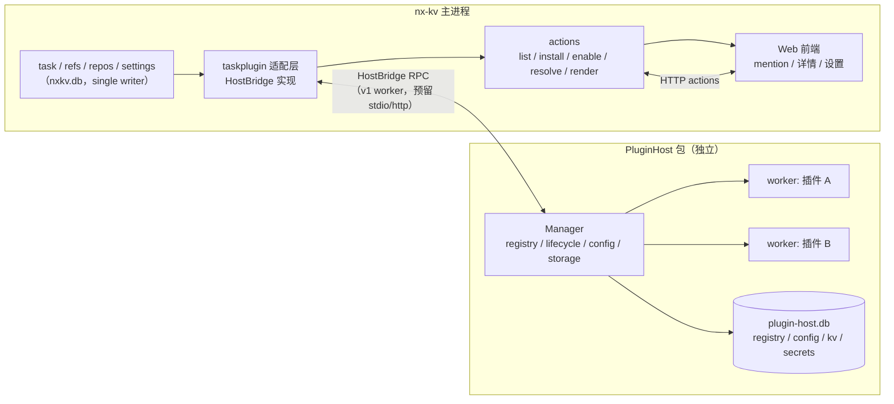

# nx-kv task 插件系统技术调研：独立插件管理器、pretask/gettask 与 UI 插件化

> 覆盖任务 #202 / #203。本文是**技术调研与选型建议**，不是实现方案，也没有改任何代码。
> 上一版设计稿 `ref_1890f57a635073a3` 中「`attachments.kind='plugin'`」的方案与决策「插件不该是附件」冲突，已作废；本文取代它在选型层面的结论，旧文保留仅作历史记录。

## 0. 结论摘要

1. **插件管理器做成独立包是可行的，也是推荐方向。** 包名暂定 `@nx-kv/task-plugin-host`（下称 PluginHost），只依赖 Node 内置能力与 `zod`，不反向依赖 nx-kv。nx-kv 只实现一个薄的 `HostBridge`（任务 / 文档 / 仓库 / 设置 / 队列的只读快照与受控写入口），通过它和 PluginHost 通信。
2. **进程模型推荐「管理器 + 每插件一个 `worker_threads` worker」作为 v1。** 协议按可切换 sidecar（stdio / 本地 HTTP）设计，插件 ABI 不因传输层变化而变。纯库内嵌适合做 P0 原型，不建议承载第三方插件。
3. **只做两个生命周期切入点是对的。** `pretask` 挂在 `submitTask()` 之前，`gettask` 挂在 `assembleDelivery()` 里。插件资源列表 / 文本化 / 树展开属于**资源 API**，不是第三个生命周期钩子，避免把 UI 交互误做成生命周期。
4. **插件资源不进附件管线。** 新增 `task_plugin_links` 表 + 正文语法 `nxkv-plugin://<pluginId>/<resourceId>`；正文里是用户可见的链接，库里是权威的链接行；不写 `attachments` / `task_attach`。
5. **UI 插件化分三层渐进落地：**
   - **A 声明式（默认，P1）**：插件在 manifest 里声明 mention 分组、资源条目、详情区块、配置 schema；nx-kv 用自己的组件渲染。文件树、skill 链接、提示词模板都能覆盖。
   - **B 可信同源 bundle（P2）**：只对一方 / 已验证插件开放；插件发布 `client.js`，通过类型化 slot 注册 React 组件，共享 React 与 nx-kv UI 组件表。这是 DSH 的做法。
   - **C iframe 沙箱（P3）**：第三方不可信插件用 `sandbox` iframe + `postMessage` RPC，权限化读取，样式靠设计令牌桥。这是 magpie 外部插件页面的做法。
6. **变量系统统一用 JSON Schema 描述。** 内置插件继续 zod → `PluginSchema`；外部插件在 manifest 里交 JSON Schema（zod 在构建期转出）。宿主用同一个目录派生器生成「插入变量」面板、模板白名单与配置表单。
7. **promptplug 建议保持内置核心。** 外部插件通过同一个 `PromptSectionContribution` 接口往 get 链追加段；「promptplug 做成插件」若要做，也只能以**内置可信插件**形态运行并拿完整 `HostContext`，不享受外部隔离。
8. **仍未拍板、实现前需要确认的**：管理器进程模型（worker / sidecar / 内嵌）、UI 从 A 还是 A+B 起步、包放独立仓库还是本仓 `packages/`、管理器存储是否独立 SQLite、信任分级与默认权限、链接 URI 语法。

---

## 1. 需求还原与边界

### 1.1 #202 的六个原始诉求

| # | 原话要点 | 调研结论 |
| --- | --- | --- |
| 1 | 挂载 DSH / magpie，看插件的底层设计、生命周期、存储 | 已完成深读；可借的是模式，不是运行时 |
| 2 | 写 task 时 `/`、`@` 唤出插件列表，选择后按插件规则文本化，给 task 链接资源；get 时像 promptplug 一样渲染；函数与 DIY 存储由插件提供；可提供文件树 / skill 链接 / 可展开 UI | 需要「资源 API + 链接模型 + get 段注入 + UI 贡献」四件套 |
| 3 | 插件不该是附件 | 新表 + 新 URI 语法，不复用附件 |
| 4 | 变量系统展示也自动生成；内置 + 用户自定义模板；promptplug 用 zod | 统一 schema 描述 + 目录派生 + 模板白名单 |
| 5 | 更在意软件的设计感和长远生态 | 宿主拥有设计系统；声明式优先；ABI 版本化；信任分级 |
| 6 | promptplug 做成插件后内部上下文能否访问 | 能，但只能通过宿主注入的 `HostContext` / `HostBridge`，不能直接拿内部对象 |

### 1.2 #203 的补充边界

- 插件管理器是**一个单独的包**，nx-kv 只和它通信；包负责插件周期管理。
- 只做 **task 链路插件化**，不做 nx-kv 底层全面插件化。
- 只要两个关键切入点：`pretask` 与 `gettask`。
- 当前真正没想清的是：**UI 怎么插件化**。

### 1.3 本文不做什么

- 不决定 npm 包名、仓库归属、许可证。
- 不设计插件市场 / 签名体系，只给出可扩展的信任分级。
- 不修改 `promptplug`、`claim`、`localtask`、前端任何现有代码。

---

## 2. 现状盘点（只列与插件系统直接相关的事实）

### 2.1 nx-kv 已经有的地基

**提示词段插件（promptplug）已经是一个成熟的「编译期插件」：**

- 注册面 `AnyPromptPlugin`：`id / order / group / tag / label / templates / schema / get()`，见 `src/shared/prompt-plugin.ts:50-65`。
- `assertPluginList()` 在启动期强制：id 唯一、链内 order 唯一、模板非空、tag 合法、模板变量只能引用 seed ∪ 本段 schema，见 `src/shared/prompt-plugin.ts:75-97`。
- zod `dataSchema` → `PluginSchema`（纯数据 fields / blank）的桥，见 `src/modules/promptplug/schema-bridge.ts:140-151`；UI 的变量目录与模板白名单都从这里派生。
- 链式组装：`buildPlugins(group)` 按 `get / check / done` 建链，见 `src/modules/promptplug/factory.ts:53-90`；`compose()` 按 order 取数、渲染、包 XML 标签，见 `src/modules/promptplug/compose.ts:64-100`。
- 用户模板层按段落 settings（`prompt.tpl.<segment>`），见 `src/modules/promptplug/template-store.ts:303-311`；出厂模板仍在插件类里。
- 设置页完全消费 `/api/prompt/registry`，见 `src/web/frontend/page/settings/prompt-templates-section.tsx:60-116`。

**交付链路只有一个组装点：**

- `buildTaskDelivery()` 完成附件标注、时间目标、组上下文、队列余量取数，然后交给 `assembleDelivery()`，见 `src/modules/claim/host.ts:116-229`。
- `assembleDelivery()` 构造 seed、建三条链、调 `compose({ groups: ['get','check','done'] })`，见 `src/modules/claim/assemble.ts:93-145`。
- **`gettask` 的唯一自然接入点就在这里**：在 seed 之后、compose 之前/之中插入插件段。

**任务提交只有一个编排点：**

- CLI / HTTP / 面板提交 / 远程导入全部走 `submitTask()`，见 `src/modules/localtask/lifecycle/add.ts:59-114`；`localtask.add` action 只做参数归一后委托，见 `src/modules/localtask/actions/localtask-add.ts:59-103`。
- **`pretask` 的唯一自然接入点就在这里**：`submitTask()` 解析完 text / 归属后、`addTask()` 之前。

**CLI 与 HTTP 同源、前端页面有显式注册表：**

- action 装饰器同时声明 CLI 与 HTTP，路由由 `action.http` 编译，见 `src/runtime/action-decorator.ts:56-88`、`src/runtime/api.ts:1-15`。插件管理器的 list / install / enable / resolve 等操作可以按这个模式暴露，CLI 与面板同源。
- 前端页面总表是 `PAGES`，见 `src/web/frontend/routes/index.ts:15-33`；新增插件管理页 / 插件详情页需要在这里登记。
- 静态文件只从 `src/web/public` 发，见 `src/runtime/server.ts:13-55`；**运行时插件 UI 资源需要新增一个受控路由**（如 `/plugins/<id>/...`），不能直接塞进 PUBLIC_DIR。

**mention UI 已有可复用的交互骨架：**

- `@` 触发判定与引用语法生成在 `src/web/frontend/modules/md/attach-mention.ts:14-75`。
- 附件选择面板（搜索 / ↑↓ / 插入）在 `src/web/frontend/components/md/attachments/attach-picker.tsx:1-130`；斜杠菜单另有 `use-slash-menu.ts` / `slash-menu.tsx`。
- 插件列表不需要新造菜单，只需要给现有 composer 增加一个 **mention source**（资源来源），并在 pick 后走插件文本化。

**数据库现状：**

- 迁移机制 `DIRECT_EDGES` 已到 v18，见 `src/core/db/migrations/index.ts:55-74`；当前**没有任何插件相关表**。
- 现有附件模型是 `attachments / task_attach / ref_attach`；插件资源明确不复用这条管线。

### 2.2 DSH 可借的东西（已对着源码/README 核对）

| 模式 | 事实 | 对 nx-kv 的用法 |
| --- | --- | --- |
| 生命周期状态机 | `PENDING → LOADING → ACTIVE → UNLOADING → DISPOSED`，失败进 `FAILED`；`dispose()` 等异步 disposer 并递归卸载子插件 | 插件管理器用它做 `installed / enabled / pending / active / failed / disposed` |
| 可逆注册 | `ctx.effect()` 返回 disposer；工具、事件、路由、提示词段注册都可撤销；撤销逆序 | 插件的 mention source、prompt section、HTTP 路由、缓存都通过 effect 登记 |
| 依赖服务 | `inject` / `Provides` / `Requires`；依赖消失自动卸载，恢复自动重载 | 插件之间只通过 `provides / requires` 通信，禁止互相 import |
| 安装与启用分离 | `plugin add/remove` 改依赖与选择；`enable/disable` 改 patch；都不是「装上就生效」 | PluginHost 的 install / enable / activate 三态分开 |
| 提示词分段 | `systemPrompt.section({ name, order, text })`，同名按作用域覆盖，注册返回 disposer | 外部插件的 get 段用 `order >= 100` 的保留区间，内置段 1–99 |
| 存储域 | `DomainSpec { name, version, layout, compatibleVersions, invalidRecords, tables }`；打开顺序严格、记录 schema 校验、失败隔离 | 插件自己的持久状态用带版本的 domain / namespace，不直接写 nxkv.db |
| **UI 模块系统** | 插件包在 `package.json` 声明 `dsh.client`，宿主把每个 bundle 挂到 `/plugins`；浏览器侧惰性加载、共享 `PLATFORM_MODULES`、支持 HMR / release 匹配 | 若做 B 层（可信 React bundle），这套「bundle 路由 + 共享模块表 + 惰性加载」可直接借鉴 |
| **UI slot 注册表** | `ui-slots` 提供 `single / list / keyed / chain / hoc` 五种 slot；注册即声明，冲突加载期报错；disposer 递归移除子 slot | nx-kv 的 B 层 slot 契约按这个设计，避免运行时抢位 |
| **输入触发流水线** | `/` 与 `@` 统一触发，分组候选、键盘/指针、下钻、异步预热、pick 路由到 source | 插件 mention 直接做成一类 source；文件树用 `drill: true` 下钻 |
| 配置同步 | 只有 `.volatile()` 字段下发浏览器；密钥永不下发；字段级变更通知 | 插件配置 UI 只拿非敏感字段；密钥留在 Host |
| 受限 iframe | `script-realm-iframe` 每个 realm 一个同源隐藏 iframe；明确「同源不提供恶意代码隔离」 | 不可信 UI 应使用**无 same-origin 的 sandbox iframe**，不能只靠同源 iframe |

### 2.3 magpie 可借的东西（已对着源码核对）

| 模式 | 事实 | 对 nx-kv 的用法 |
| --- | --- | --- |
| 内置插件 Manifest | `ID / API / Requires / Provides / Essential / InUse / Apply / Parts / SetAt / Opens / Defaults / Settings / Client`，见 `internal/pluginrt/pluginrt.go:35-82` | 插件清单的字段可裁成 nx-kv 版 |
| 拓扑启停 | `Reconcile` 先算下线集合（依赖将下线服务的插件递归加入），按 order 从新到旧 dispose；再反复上线直到无新可应用 | PluginHost 的 `rebuild()` 用同一套「先下后上」 |
| 失败隔离 | 单插件 `Apply` 报错/panic → 该插件 `failed` 并撤销已注册内容，其余继续 | 插件失败不拖垮 get；required 才 fail-closed |
| `InUse` 硬约束 | 用户已经用插件创建了对象 → 无论配置怎么写都保持开启 | 任务里已有插件链接时，禁用插件要显式警告 / 保留数据 |
| 配置四层合成 | 内置默认 → preset → 用户行 → in use；每字段带来源 | 插件配置默认值写在 manifest schema，只落用户差异 |
| **外部插件页面** | `WindowSpec { Page, Panels, Actions, Reads }`；页面 HTML 在插件目录，**在独立 frame 里绘制**；`PageReads` 只给 `usage:summary / usage:day / providers:list` 这类无密钥读 | 不可信 UI 的 C 层直接照这个模型：HTML + iframe + 权限化读取 |
| 页面 / 面板 slot | `PanelSlots = [agents, usage, settings, provider]`；`Replaceable = [sessions, library, routing, usage]` | nx-kv 的 C 层先给固定 slot，不让插件替换核心页面 |
| 安装/启用分离 | `plugins.json` 的 `Entry{Spec, Off, Options}` 与内置 `plugins.yml` 的 `preset/enabled` 分开 | 同 DSH，install / enable 分开 |
| 宿主通信 | 外部插件跑在 Bun 宿主，Go 侧通过 stdio 通信；更新用 retire 而非立即 kill | B/C 层的进程外通信与热更新策略参考 |

### 2.4 盘点结论

nx-kv 缺的不是「再写一个 promptplug」，而是四件事：

1. **清单与生命周期**：插件是什么、装没装、启没启、依赖谁、失败怎么办。
2. **资源域**：插件能提供哪些外部资源、怎么列、怎么搜、怎么文本化、怎么和 task 建立链接。
3. **UI 贡献**：mention 分组、详情区块、树展开、配置表单。
4. **外部存储**：插件自己的命名空间、版本化、配额与清理。

---

## 3. 关键选型对比

### 3.1 插件管理器的进程模型

| 方案 | 隔离 | 崩溃影响 | 生态 / 安装 | 实现成本 | 调试 | 结论 |
| --- | --- | --- | --- | --- | --- | --- |
| A 纯库内嵌（同线程） | 无 | 插件异常可拖垮 nx-kv 主进程 | 最简单 | 最低 | 最好 | 只适合 P0 原型 / 内置插件 |
| **B 库 + 每插件 worker** | 线程级，插件崩溃只死 worker | 管理器可重启 worker | npm 包 / 本地目录都行 | 中 | 较好（worker 日志独立） | **推荐 v1** |
| C sidecar 进程 | 进程级 | 完全不影响 nx-kv | 需要 socket / 端口 / 生命周期监督 | 中高 | 中（跨进程日志 / 断线重连） | 协议预留，P2 可选 |
| D 外部运行时（Bun / Deno / QuickJS） | 运行时级 | 隔离最好 | 生态分裂、打包/安装成本高 | 高 | 差 | 只对不可信插件市场考虑 |

**推荐：B。** 理由：

- 「插件管理器是独立包、nx-kv 只通信」并不要求跨进程。包 + worker 已经满足「管理器拥有生命周期、nx-kv 不碰插件代码」。
- 每个插件一个 worker，可以做到：单插件超时 / 崩溃 / 卡死时 `terminate()`；插件内存与主进程隔离；插件之间不能直接共享对象，只能走管理器路由。
- 协议设计成传输无关：`PluginHostTransport` 接口下，v1 是 `worker`，以后加 `stdio` / `http` 不需要改插件 ABI。
- 不建议 v1 做 sidecar：Windows 下 socket / 进程清理 / 端口占用都会增加交付面；等真有「插件热更新 / 独立升级」需求再上。

**不推荐的路线：**

- 不做「nx-kv 内 `node:vm` 直接跑插件」：`vm` 不是安全边界，且无法限制 CPU / 内存。
- 不把 Cordis 作为 nx-kv 的核心架构：Cordis 的概念密度（Service / inject / fiber / effect / waterfall / scope）远超两个切入点的需求，且 DSH 仍是 alpha。可以在 PluginHost **内部**借鉴 Cordis 的 effect 栈与依赖拓扑，不暴露给 nx-kv。

### 3.2 插件代码形态与信任分级

| 等级 | 运行位置 | 能力 | 适用 |
| --- | --- | --- | --- |
| `builtin` | nx-kv 主进程 / 内置注册表 | 全部 HostContext | promptplug、官方内置段 |
| `trusted` | 独立 worker | 声明式 `permissions`：`repo / refs / tasks / fs / http / secrets` | 一方插件、用户明确信任的本地插件 |
| `untrusted` | 独立 worker + iframe UI | 默认无 fs / 无网络；只给资源与模板 | 第三方市场插件 |

关键约束：

- 插件不能直接打开 `nxkv.db`，也不能拿 `Container` / `DbApi`；只能通过 HostBridge 的受控方法。
- 插件的 secrets 与 prompt 上下文隔离：secrets 不进 gettask 的模板变量，也不下发浏览器。
- 任何 `exec` / 任意 fs 能力必须是显式权限 + 安装时确认；默认拒绝。

### 3.3 UI 插件化

| 方案 | 能做什么 | 设计一致性 | 安全 | 生态成本 | 适用 |
| --- | --- | --- | --- | --- | --- |
| **A 声明式宿主渲染** | mention 分组、资源条目、树、详情区块、配置表单 | 最高（宿主组件） | 最高（不执行插件 JS） | 最低（manifest + JSON Schema） | **默认，P1** |
| **B 可信同源 bundle + slot** | 任意 React 组件、复杂交互 | 中（靠组件库约束） | 低（任意 JS 在页面内） | 中高（构建、共享模块表、版本） | 一方 / 已验证插件，P2 |
| **C iframe 沙箱** | 任意前端框架、独立页面 | 中低（设计令牌桥） | 高（sandbox + postMessage） | 中（桥 + 权限 + 资源路由） | 第三方不可信插件，P3 |
| D Web Component | 框架无关、样式隔离 | 中（shadow DOM 样式桥） | 中（仍需 JS 执行） | 中 | 可作为 C 的替代实现 |

**推荐：A 默认，B 对可信插件开放，C 对第三方开放。** 理由：

- 用户要的「文件树、skill 链接、可展开 UI」在 A 层就能覆盖：树是宿主组件，插件只提供节点与懒加载回调；skill 链接是资源条目；展开是宿主行为。**不需要为了一个树就引入运行时 React 插件。**
- 「设计感」要求宿主掌握视觉语言。A 层插件只给语义（`label / icon / order / kind`），不给 CSS；B 层也只允许用宿主 UI 组件与令牌；C 层通过 CSS 变量桥尽量对齐。
- 「长远生态」要求先有稳定的贡献 schema，再开放任意 UI。先 A 后 B/C，能把 ABI 稳定下来再扩容。

### 3.4 schema 与变量系统

| 方案 | 优点 | 缺点 | 结论 |
| --- | --- | --- | --- |
| 只用 zod | 类型推导强、现有 promptplug 已用 | 跨进程 / 跨语言不能直接传 zod 实例；外部插件被迫依赖同一 zod 版本 | 内置继续用，外部不用 |
| **JSON Schema（子集）作为交换格式** | 语言无关、可校验、可生成表单 | 需要写一个 walker（可复用 `schema-bridge` 的思路） | **推荐作为 manifest 的规范格式** |
| Schemastery（DSH） | 配置与 UI 一体 | 生态绑定 DSH；nx-kv 已选 zod | 不引入 |
| 手写 UI 字段目录 | 简单 | 两份真相，必然漂移 | 禁止 |

**推荐：**

- 内置插件：zod `dataSchema` → `PluginSchema`（现状不变）。
- 外部插件：manifest 里交 JSON Schema（用 zod 在构建期 `z.toJSONSchema()` 或等价工具产出）；PluginHost 校验后转成同一个 `PluginSchema` / `FieldDecl` 结构。
- 一份 schema 同时服务：变量目录（插入变量面板）、模板白名单、配置表单、资源条目展示字段。
- 配置表单只支持受控子集：`string / text / number / boolean / enum / array / object`，加 `x-ui: { widget, placeholder, help }`；复杂 UI 走 B/C。

### 3.5 存储归属

| 数据 | 归属 | 理由 |
| --- | --- | --- |
| 已安装插件 registry / 版本 / hash / 启用态 | PluginHost（独立 SQLite 或文件） | 生命周期归管理器，nx-kv 不关心插件怎么装 |
| 插件配置（用户可改） | PluginHost | 与 manifest 默认值分层，只落差异 |
| 插件自身持久状态 / KV | PluginHost，按 `pluginId + namespace` 隔离 | 插件 DIY 存储，但不能碰 nx-kv 表 |
| 插件 secrets | PluginHost，独立文件 `0600` | 不进配置、不进 prompt、不下发 UI |
| task ↔ 插件资源链接 | **nx-kv**（`task_plugin_links`） | 这是任务域数据，随任务备份 / 迁移 / 删除 |
| 插件包本体 / 缓存 | PluginHost 目录 | 可重建的放 cache，权威包按版本目录 |

**推荐：管理器拥有自己的库，nx-kv 只拥有「任务链接」与「任务正文」。** 这样：

- 管理器可以独立升级 / 备份 / 迁移，不会和 nx-kv 的 v19 迁移耦合。
- nx-kv 的 single-writer 模型不被打破（管理器写自己的库）。
- 任务链接仍在 nxkv.db，任务删除时 `ON DELETE CASCADE`，不依赖插件管理器在线。

---

## 4. 推荐架构

### 4.1 组件图



### 4.2 包边界与 API

PluginHost 对外只暴露三类东西：

```ts
// 1) 管理器：生命周期
interface PluginHost {
  list(): Promise<PluginSummary[]>;
  install(spec: InstallSpec): Promise<PluginSummary>;   // 落盘 + 校验，不激活
  uninstall(id: string): Promise<void>;                 // 先 disable
  enable(id: string): Promise<void>;                    // 写配置，下次 rebuild 激活
  disable(id: string): Promise<void>;                   // 撤销注册
  rebuild(): Promise<PluginSummary[]>;                  // 拓扑启停
  config(id: string): Promise<JsonSchema>;
  setConfig(id: string, value: unknown): Promise<void>;
}

// 2) 两个生命周期钩子
interface PluginHostHooks {
  pretask(input: PretaskInput): Promise<PretaskResult>;
  gettask(input: GettaskInput): Promise<GettaskResult>;
}

// 3) 资源 API（UI 用，不是生命周期）
interface PluginResources {
  search(input: ResourceQuery): Promise<ResourceItem[]>;
  list(input: ResourceList): Promise<ResourceItem[]>;    // 树展开
  describe(input: ResourceRef): Promise<ResourceDetail>;
  render(input: ResourceRef): Promise<ResourceRender>;   // 文本化
  commands(): Promise<PluginCommand[]>;                  // '/' 动作
  runCommand(input: CommandRun): Promise<CommandResult>;
}
```

nx-kv 侧的 `HostBridge`：

```ts
interface HostBridge {
  // 只读快照：由 nx-kv 在调用时组装，插件拿不到 DbApi
  task(id: number): Promise<TaskSnapshot | null>;
  refs(ids: string[]): Promise<RefSnapshot[]>;
  repos(keys: string[]): Promise<RepoSnapshot[]>;
  groupContext(boardKey: string): Promise<GroupContext | null>;
  settings(keys: string[]): Promise<Record<string, unknown>>;
  // 受控动作：由 nx-kv 校验权限后执行
  readFile(path: string, opts: { maxBytes: number }): Promise<FileSnapshot>;
  http(input: HttpRequest): Promise<HttpResponse>;
  log(entry: LogEntry): void;
}
```

约束：

- PluginHost **不 import nx-kv 任何源码**；HostBridge 由 nx-kv 实现并注入。
- 插件 **不 import PluginHost 内部实现**；只拿 `ctx`（config / storage / logger / host 代理）。
- 协议消息带 `apiVersion`，管理器按 `^1` 主版本匹配；不匹配 → `failed`，不静默降级。

### 4.3 两个切入点

#### pretask：提交前

位置：`submitTask()` 解析 text / 归属之后，`addTask()` 之前（`src/modules/localtask/lifecycle/add.ts:59-114`）。

```ts
interface PretaskInput {
  draft: {
    text: string;
    cwd: string;
    board?: string;
    project?: string;
    params: Record<string, string>;
  };
  /** 用户在 / @ 菜单里已选的插件资源（前端先提交一次“已选链接”到服务端） */
  links: PluginLink[];
  /** 宿主上下文：只读 */
  context: HostContext;
}

interface PretaskResult {
  /** 允许插件追加 / 修正正文；宿主在 UI 里展示 diff 或至少写回执 */
  text?: string;
  /** 校验 / 归一后的链接；新增链接必须带插件自己的 resourceUri */
  links?: PluginLink[];
  /** 非致命问题，进任务提交回执与日志 */
  warnings?: string[];
  /** 只有显式 required 的插件才允许拒绝提交 */
  reject?: { message: string };
}
```

失败语义：

- 普通插件超时 / 抛错 → 跳过该插件，任务照常提交，warning 回执。
- `required: true` 的插件失败 → 拒绝提交，错误里带插件名与原因。
- 总预算建议 2s；单插件 800ms；并发执行，按 `order` 合并结果。
- 正文改写必须可审计：任务创建回执里记录「哪个插件改了什么」，面板任务详情可见。

#### gettask：交付组装时

位置：`assembleDelivery()` 内（`src/modules/claim/assemble.ts:93-145`），在 seed 构造后、`compose()` 前。

```ts
interface GettaskInput {
  task: TaskSnapshot;                 // id / text / board / project / cwd
  links: PluginLink[];                // 本任务的插件资源
  seed: {
    goal: unknown | null;
    group: unknown | null;
    cwd: string;
    params: Record<string, string>;
  };
  context: HostContext;
}

interface GettaskResult {
  sections: Array<{
    id: string;                       // 全局唯一：pluginId.sectionId
    tag: string;                      // 如 nx-kv.plugin.filetree
    order: number;                    // 插件段强制 >= 100
    /** 插件给数据 + 模板，宿主渲染；也可直接给 text（不参与变量白名单） */
    data?: unknown;
    template?: string;
    text?: string;
    required?: boolean;
  }>;
  warnings?: string[];
}
```

合并规则：

- 内置段 order 1–99；外部插件段 order 100–999；同一 order 冲突时启动期报错（保持 promptplug 的严格性）。
- 每段的数据域 = seed ∪ 本插件声明的 `dataSchema`；模板变量白名单沿用 `undeclaredTemplateVars()`。
- 段渲染为空 → 不输出；`required` 段渲染失败 → 整次交付失败（与内置段同一纪律），普通段失败 → 跳过 + `renderWarnings`。
- 真实领取与预览共用同一条路径；trace 里记录 `pluginId / version / hash / sectionId`，保证可复现。

#### 明确不是第三个钩子

以下都属于资源 API，不应做成生命周期：

- `/` 命令：列出动作、执行动作（例如「插入一段插件模板」）。
- `@` 资源：搜索 / 列表 / 树展开 / 文本化。
- 任务详情里的资源预览。
- 设置里的插件配置。

### 4.4 资源与链接模型（插件不是附件）

**正文语法：**

```md
[文件树 · src](nxkv-plugin://file-tree/tree/src)
```

- `nxkv-plugin://<pluginId>/<resourceId>`，`resourceId` 由插件定义（可以是路径、哈希、URL 编码串）。
- 选择时由插件 `resources.render()` 返回 `{ title, snippet, link }`；`snippet` 插进正文，`link` 是上面的规范 URI。
- 正文里是用户可见、可编辑、可复制的 markdown 链接；不是隐藏 HTML 注释。

**数据表：**

```sql
CREATE TABLE task_plugin_links (
  id            TEXT PRIMARY KEY,
  task_id       INTEGER NOT NULL REFERENCES tasks(id) ON DELETE CASCADE,
  plugin_id     TEXT NOT NULL,
  plugin_version TEXT NOT NULL,
  resource_uri  TEXT NOT NULL,
  resource_kind TEXT NOT NULL,
  title         TEXT NOT NULL,
  payload_json  TEXT NOT NULL DEFAULT '{}',
  content_hash  TEXT NOT NULL DEFAULT '',
  created_at    TEXT NOT NULL,
  updated_at    TEXT NOT NULL,
  missing_at    TEXT,
  UNIQUE(task_id, plugin_id, resource_uri)
);
```

口径：

- **不是附件**：不写 `attachments`，不写 `task_attach`，不走附件标注 / 同步 / 本地路径那一套。
- 链接行是权威：任务复制 / 重开 / 派生时复制行；插件卸载后行保留，`missing_at` 标记。
- `payload_json` 是插件选择时的稳定快照（例如文件树根、skill id），不是缓存正文；正文仍由 `gettask` 现算。
- `content_hash` 用于判断资源是否变化；变化只影响提示词里的标注，不自动改任务正文。
- 删除任务 → 级联删除链接；删除插件 → 不动任务链接，只标记 missing。

**mention 流程：**

1. 用户在 composer 输入 `/` 或 `@`。
2. 宿主打开统一菜单，调用 PluginHost 的 `resources.search / commands`，按插件分组。
3. 选择条目后：
   - `@` 资源：调用 `resources.render(uri)`，插入 `snippet` + `link`，并把 `link` 记入待提交的 `links`。
   - `/` 命令：调用 `runCommand`；命令可以插图、插模板、打开插件预览。
4. 提交任务时，`pretask` 收到 `links`，校验 / 归一；服务端再从正文解析 `nxkv-plugin://` 链接，和显式 links 去重合并后写库。

### 4.5 UI 插件化（重点）

#### A 层：声明式贡献（默认）

manifest 里的 `ui` 只描述「贡献什么」，不描述「怎么画」：

```ts
interface PluginUiManifest {
  mention?: {
    trigger: '@' | '/' | 'both';
    label: string;
    icon?: string;                  // 资源 id 或包内相对路径
    search?: boolean;
  };
  resources?: Array<{
    kind: string;                   // 'file' / 'skill' / 'tree' / 'prompt'
    label: string;
    icon?: string;
    itemFields: JsonSchema;         // 条目展示字段（宿主渲染）
    view?: 'list' | 'tree' | 'markdown' | 'kv';
  }>;
  detail?: Array<{
    id: string;
    title: string;
    order: number;
    view: 'markdown' | 'tree' | 'kv';
  }>;
  settings?: JsonSchema;            // 宿主自动生成配置表单
  commands?: Array<{ id: string; label: string; icon?: string }>;
}
```

宿主渲染规则：

- **mention 菜单**：复用现有菜单样式；插件分组标题 + 条目图标/标题/说明；搜索匹配 `label + name`；`tree` 资源用 `drill`（右箭头 / Tab）展开下一层，调用 `resources.list({ parentUri })` 懒加载。
- **条目展示**：`itemFields` 是 JSON Schema 子集，宿主只渲染白名单字段，不执行插件代码。
- **详情区块**：`view: 'markdown' | 'tree' | 'kv'`；树节点 `{ id, label, icon?, expandable?, badge? }`；展开走同一 `resources.list`。
- **配置表单**：`settings` 直接生成；字段级 help / placeholder / enum；保存走 `plugin.setConfig`。
- **变量目录**：从资源 `itemFields` / gettask `dataSchema` 自动生成，插进模板编辑器；与 promptplug 的变量面板同一套组件。

这一层能覆盖用户举的三个例子：

| 需求 | A 层怎么落 |
| --- | --- |
| 文件树 | `resources.kind='tree'`，`view='tree'`，`resources.list` 懒加载；pick 后 `render` 返回路径 + 摘要 |
| skill 相关链接 | `resources.kind='skill'`，条目字段 title/desc/path；链接 URI 指向 skill 资源 |
| 插件提供 UI 支持展开 | 树节点 + 详情区块展开；宿主负责视觉与交互 |
| 提示词模板控制 | 插件自带 templates + schema；用户在设置页覆盖；gettask 渲染 |

#### B 层：可信同源 bundle + slot（P2）

只对一方 / 已验证插件开放，manifest 增加：

```json
{
  "ui": {
    "bundle": "./client.js",
    "api": "^1",
    "slots": ["task.composer.mention.source", "task.detail.section", "settings.plugin.config"]
  }
}
```

- 宿主新增受控静态路由 `/plugins/<id>/client.js`（以及包内 assets），只服务已启用、已校验 hash 的插件。
- 前端新增一个轻量 loader：`import(/* @vite-ignore */ url)`，加载后调用插件的 `register(ctx)`；`ctx.slots.register()` 返回 disposer。
- 共享模块表（防止 React 双实例）：`react`、`react-dom`、`nx-kv/ui`（宿主组件）、`nx-kv/design-tokens`。插件 bundle 必须 external 这些模块。
- slot 类型建议（nx-kv 版）：

| slot | kind | 用途 |
| --- | --- | --- |
| `task.composer.mention.source` | list / keyed | 自定义 mention 行 / 下钻 |
| `task.composer.after` | list | composer 下方工具条 |
| `task.detail.section` | list | 任务详情 tab / 区块 |
| `settings.plugin.config` | keyed | 插件自己的配置页 |
| `settings.prompt.segment` | keyed | 提示词段的自定义编辑器 |
| `board.task.badge` | list | 任务卡角标（可选） |

- 设计约束：只能用宿主 UI 组件与设计令牌；禁止全局 CSS；bundle 不能直接访问 `window.nxkv` 内部对象，只能通过注入的 `ctx`。
- 失败：bundle 加载 / 注册失败 → 该 slot 空着 + 面板提示；不影响其他插件和核心 UI。

#### C 层：iframe 沙箱（P3）

对第三方不可信插件：

- manifest 声明 `ui.page` / `ui.panels[]`，插件包里是 HTML + JS + CSS。
- 宿主 `/plugins/<id>/page.html` 以 `sandbox="allow-scripts"`（**不加 `allow-same-origin`**）加载；`postMessage` 做 JSON-RPC。
- 权限：manifest `permissions` 决定可调用哪些 HostBridge 读方法（参考 magpie 的 `PageReads`，只给无密钥读）。
- 样式：宿主在握手时下发 CSS 变量（颜色 / 字号 / 圆角 / 间距）；插件自己负责布局。
- 尺寸：宿主控制 iframe 容器；插件上报内容高度；弹层限制在容器内。
- 明确：iframe 不是万能的；`sandbox` 能挡 DOM / cookie，但插件仍可发起网络请求（除非 CSP / 代理限制），所以网络权限仍要显式授予。

#### UI 层的共同规则

1. **设计系统归宿主**：插件只给语义，不给核心表面的像素。A 层完全宿主渲染；B 层用宿主组件；C 层用令牌桥。
2. **来源可追溯**：每个区块带插件名 / 版本徽标；任务详情能看「这个链接来自哪个插件」。
3. **可关闭**：任何插件 UI 区块都能在设置里关掉；关掉后任务链接仍在，只是不渲染。
4. **不阻塞核心路径**：mention 菜单、任务详情、get 交付都不能因为插件超时而卡死；统一超时 + 跳过 + 告警。
5. **不做「插件替换核心页面」**：先只开固定 slot，避免插件把任务页 / 设置页整体换掉，破坏设计一致性。

### 4.6 提示词模板与变量

- 插件 manifest 的 `templates` 是出厂默认；用户覆盖存 PluginHost 的配置域（或 nx-kv settings？推荐 PluginHost，保持插件数据自洽）。
- 覆盖优先级：**用户启用模板 > 插件出厂模板 > 宿主内置段**。
- 变量白名单：`seed ∪ 本插件 dataSchema`；继续用 `undeclaredTemplateVars()`；外部插件模板在启用前做一次校验，非法模板回落出厂模板并告警。
- 变量目录：从 JSON Schema 派生 `FieldDecl`（key / kind / label / desc / enumValues），插入变量面板与 promptplug 共用。
- 预览：`assembleDelivery` 的 trace 记录每段来源；插件段的 `templateName` 标「插件 <id>」。
- 不允许插件覆盖内置段的 id / order；冲突在 rebuild 时 `failed`，不静默抢位。

### 4.7 promptplug 的定位

**推荐：promptplug 保持内置核心，不变成外部插件。**

理由：

- 它依赖大量内部上下文（组上下文、附件标注、时间目标、队列余量），这些在 `claim/host.ts` 里已经是宿主取数；外部化需要序列化一整套领域对象。
- 它是 get / check / done 三链的骨架，属于「宿主提示词协议」，不适合让第三方替换。
- 它是 nx-kv 的设计基线：内置段 order 1–99、严格校验、用户模板层，这些正好可以给外部插件做示范。

**如果一定要把 promptplug 做成插件：**

- 只能以 `builtin` 信任级运行在 nx-kv 主进程（或管理器的内置通道），拿完整 `HostContext`。
- 它能访问：`task / goal / group / attach / queue / params / cwd` 的只读快照，以及 `HostBridge` 的受控读方法。
- 它不能访问：`DbApi`、`Container`、其他模块内部函数、未声明的 settings 键。
- 结论：技术上可行，但没有收益；建议把「promptplug 的接口」开放给外部插件，而不是把 promptplug 本身外置。

### 4.8 生命周期与失败语义

状态机：

```
installed ──enable──> enabled ──rebuild──> active
    │                    │                 │
    │                    │                 ├─ failed（加载/校验/依赖失败）
    │                    │                 └─ pending（依赖服务未就绪）
    │                    └─ disable ──> disabled（disposer 逆序撤销）
    └─ uninstall ──> 删除包与 registry（先 disable）
```

规则：

- **安装 / 启用 / 激活分离**：install 只落盘 + 校验 hash / API；enable 只写用户意图；rebuild 才加载。
- **依赖拓扑**：`requires / provides` 建图；下线时先撤使用者再撤提供者；循环依赖 → `failed` 并给出链。
- **失败隔离**：单插件失败只影响自己；`required` 插件失败 → 管理器报告 degraded，nx-kv 在交付里给出 warning；任务本身不因插件失败而丢。
- **超时**：单次 hook 调用有硬超时；worker 卡死 → `terminate()` + 标记 failed + 下次 rebuild 可重试。
- **配置变更**：先校验新配置，再卸载旧实例、加载新实例；新配置失败保留旧实例。
- **卸载**：先 disable；询问是否删除插件数据（默认保留链接与 KV，删包）；任务链接标记 missing。
- **可复现**：每次交付 trace 记录插件 id / version / hash；任务详情能看到「这条任务是哪个插件版本渲染的」。

### 4.9 存储设计

PluginHost 自己的库建议：

```sql
-- manager.db（独立文件）
plugins(id TEXT PRIMARY KEY, version TEXT, api TEXT, source TEXT, hash TEXT,
        state TEXT, manifest_json TEXT, installed_at TEXT, updated_at TEXT);
plugin_config(plugin_id TEXT PRIMARY KEY, config_json TEXT, updated_at TEXT);
plugin_kv(plugin_id TEXT, namespace TEXT, key TEXT, value_json TEXT,
          version INTEGER, updated_at TEXT,
          PRIMARY KEY(plugin_id, namespace, key));
plugin_logs(id INTEGER PRIMARY KEY, plugin_id TEXT, level TEXT, message TEXT,
            at TEXT);
```

目录：

```
~/.nx-kv/plugin-host/
  manager.db
  plugins/<id>/<version>/        # 包本体
  cache/<id>/                    # 可重建
  secrets/<id>.json              # 0600
```

nx-kv 侧只加 `task_plugin_links` 一张表；迁移按现有规则走 v19（DDL 独立 `.sql`，数据迁移独立脚本，迁移前 VACUUM INTO 备份，迁移后 foreign_key_check）。

### 4.10 安全与风险

| 风险 | 说明 | 对策 |
| --- | --- | --- |
| 提示词注入 | 插件资源正文、文件树、skill 描述都可能带指令 | 外部内容包在 `<nx-kv.plugin ... trust="external">` 数据段；不得覆盖系统段；模板里明确「以下为数据」 |
| 任意 JS | B 层插件在同源页面执行；C 层也不等于无网络 | B 层只给 verified 插件；C 层 sandbox + CSP + 权限；安装时明确告知 |
| 密钥泄漏 | 插件配置可能含 token | secrets 独立存储，不下发浏览器、不进 prompt；配置 schema 标 `secret` |
| 资源膨胀 | 文件树 / 缓存可能很大 | 配额、TTL、手动清理；单次返回条数上限；分页 |
| 版本漂移 | 插件 ABI / nx-kv 版本不匹配 | manifest `api: "^1"`；不匹配拒绝激活；hash 校验 |
| 不可复现 | 不同机器装不同插件，交付不同 | trace 记录 plugin id/version/hash；任务详情可见 |
| 卡死 | 插件 hook 挂起拖慢 get | 硬超时 + worker terminate；get 总预算 |
| 单写者破坏 | 插件直接写 nxkv.db | 不提供 DbApi；管理器写自己的库；所有任务写入走 nx-kv HostBridge |

---

## 5. 落地路线（建议）

### P0：协议与骨架（不碰 UI）

- 定义 manifest、HostBridge、两个 hook 的类型与错误码。
- PluginHost 包：registry + install/enable/rebuild + worker 加载 + 超时 + 状态机。
- nx-kv 适配层：`submitTask` 调 `pretask`（先只做校验 + warning），`assembleDelivery` 调 `gettask`（先只渲染纯文本段）。
- 验收：一个本地示例插件能装、启、在 get 里多输出一段；失败不影响交付；trace 能看到来源。

### P1：资源与链接 + A 层 UI

- `task_plugin_links` 表与 `nxkv-plugin://` 解析。
- `/`、`@` 菜单接入插件资源；搜索 / 列表 / 文本化 / 插入。
- A 层声明式 UI：mention 分组、条目字段、树展开、详情区块、配置表单。
- 设置页：插件列表、启停、配置、变量目录。
- 验收：文件树 / skill 链接两个示例插件可端到端使用；任务详情能看到链接来源；关闭插件后任务仍可读。

### P2：可信 bundle + 更完整的生命周期

- `/plugins/<id>/client.js` 路由、共享模块表、slot 注册表、bundle 卸载。
- B 层 slot：mention 自定义行、任务详情自定义区块、设置自定义页。
- 安装事务、版本升级、hash / API 校验、失败回滚。
- 验收：一个可信插件提供自定义树 / 表单；React 不双实例；禁用后组件卸载干净。

### P3：第三方沙箱与生态

- C 层 iframe 页面 / 面板、postMessage RPC、权限化读取、CSP。
- 插件注册表 / 市场元数据（可复用 nx-kv 的 repo 管理）。
- 验收：不可信插件在 sandbox 里运行；无权限读取被拒绝；任务交付不受影响。

---

## 6. 待拍板清单（实现前必须确认）

| # | 决策 | 推荐默认 | 备选 |
| --- | --- | --- | --- |
| 1 | 管理器进程模型 | worker / 每插件 worker | 纯内嵌；sidecar |
| 2 | UI 起步层级 | A 层（声明式） | A+B 一起 |
| 3 | 包归属 | 独立 npm 包（先本仓 `packages/` 开发） | 完全独立仓库 |
| 4 | 管理器存储 | 独立 SQLite | 复用 nxkv.db（加表） |
| 5 | promptplug | 保持内置 | 内置可信插件 |
| 6 | 插件默认权限 | 无 fs / 无网络，只读任务上下文 | 允许 repo 只读 |
| 7 | 链接语法 | `nxkv-plugin://<pluginId>/<resourceId>` | `nxkv://plugin/<id>` |
| 8 | pretask 是否允许改写正文 | 允许，但必须可审计 | 只校验不改写 |
| 9 | required 插件失败 | 拒绝提交 / 交付 | 只告警 |
| 10 | 任务链接是否随任务复制 | 是 | 否 |

---

## 7. 证据索引

### nx-kv

- 提示词段契约与校验：`src/shared/prompt-plugin.ts:46-65`、`:75-97`、`:122-157`
- zod → 注册面 schema：`src/modules/promptplug/schema-bridge.ts:140-151`
- 链构造与 compose：`src/modules/promptplug/factory.ts:53-90`、`src/modules/promptplug/compose.ts:64-100`
- 用户模板层：`src/modules/promptplug/template-store.ts:303-311`
- 交付宿主：`src/modules/claim/host.ts:116-229`
- 交付组装：`src/modules/claim/assemble.ts:93-145`
- 任务提交编排：`src/modules/localtask/lifecycle/add.ts:59-114`
- action CLI/HTTP 同源：`src/runtime/action-decorator.ts:56-88`、`src/runtime/api.ts:1-15`
- 静态文件服务：`src/runtime/server.ts:13-55`
- 前端页面注册表：`src/web/frontend/routes/index.ts:15-33`
- 提示词设置页：`src/web/frontend/page/settings/prompt-templates-section.tsx:60-116`
- `@` 触发与引用语法：`src/web/frontend/modules/md/attach-mention.ts:14-75`
- 附件选择面板：`src/web/frontend/components/md/attachments/attach-picker.tsx:1-130`
- 迁移版本：`src/core/db/migrations/index.ts:55-74`

### DSH（`D:\a_other\nxkvrepo\deepseek-harness`）

- slot 注册表：`packages/client/ui-slots/README.zh.md:26-48`
- 客户端模块 / bundle 路由 / 共享模块表 / 配置同步：`packages/client/modules/README.zh.md:12-43`、`:81-93`、`:107-122`
- 输入触发流水线（`/` `@`、下钻、异步预热）：`packages/client/ui-input-trigger/README.zh.md:12-46`
- 插件管理页的配置 slot：`packages/client/ui-plugin-manager/README.zh.md:89-118`
- iframe realm 的边界：`packages/client/script-realm-iframe/README.zh.md:28-53`
- 插件管理器 / 生命周期 / 存储：参考文档 `ref_140504d6f87b95aa`（`packages/boot/plugin-manager/README.zh.md`、`docs/subsystems/storage.zh.md`、`packages/core/system-prompt/README.zh.md`）

### magpie（`D:\a_other\nxkvrepo\magpie`）

- 内置插件 Manifest / 状态 / Ctx：`internal/pluginrt/pluginrt.go:27-82`、`:88-120`
- 外部插件页面 / 面板 / 权限：`internal/plugin/page.go:16-108`
- Settings schema → 表单：`internal/gui/builtins.go:28-62`
- 插件运行时与真实网关：参考文档 `ref_85f7a964606ee31e`（`docs/subsystems/plugin-runtime.md`、`internal/plugin/store.go`、`internal/plugin/host.go`）

### 既有文档

- `ref_140504d6f87b95aa`：DSH 插件系统深读
- `ref_85f7a964606ee31e`：magpie 主篇（含插件系统）
- `ref_1890f57a635073a3`：旧设计稿（`attachments.kind='plugin'` 部分作废）
