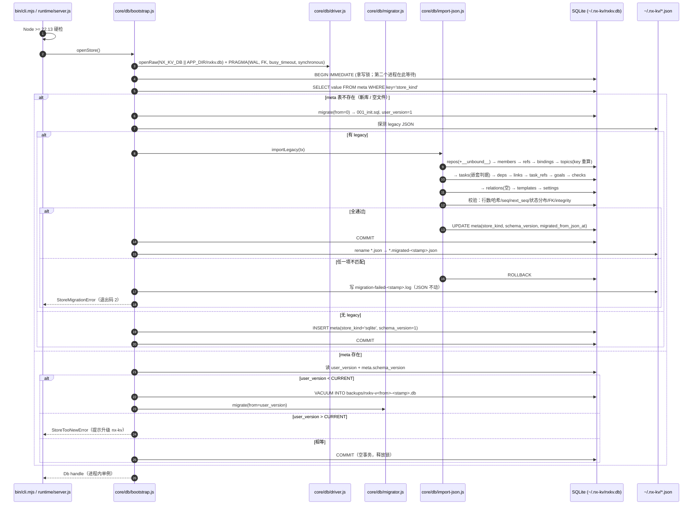
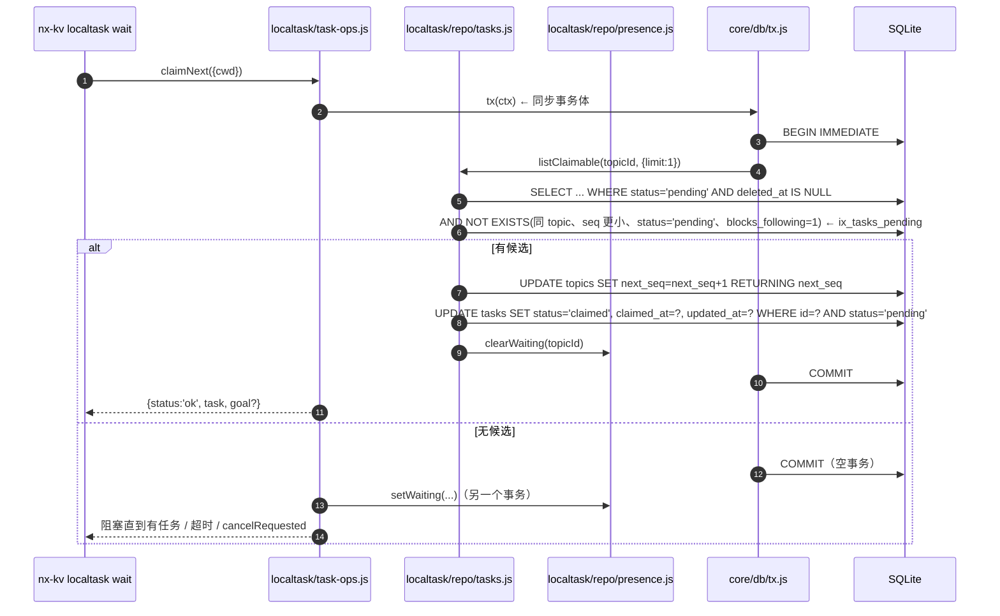
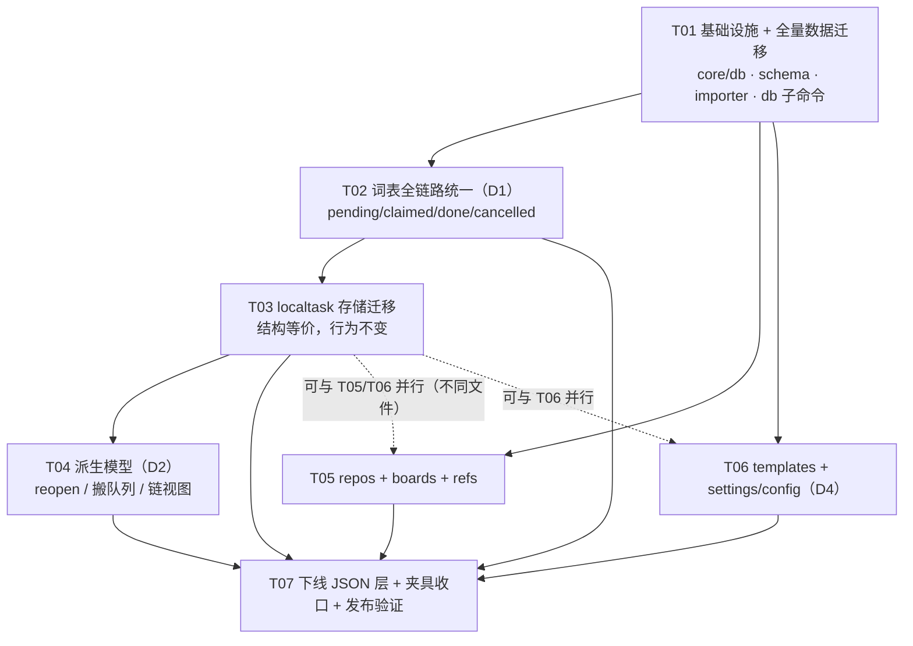

# 存储层全量重构为 SQLite · 架构设计（v2 · 已按用户裁决修订）

> 状态：**设计定稿**。第 1 节记录用户 6 条裁决与我的落地方式；第 16 节是 7 个任务的列表。
> 输入：`docs/research/entities.sql`（schema 定稿）、`pre-migration-audit.md`（迁移前审计）、
> `origin-intent.md`（原始意图，冲突时以它为准）、`template-engine-choice.md`。
> 本文里「实测」= 在本机 Node v22.22.2 / SQLite 3.51.2 / 真实 `~/.nx-kv` 数据上跑过。
>
> 与 v1 的差异：词表改为全链路统一（不做视图层映射）、reopen 改为派生模型、全局池用哨兵仓库、
> 凭据留文件而偏好进库、`topics.key` 定为「派生外部 id」。**v1 里被推翻的说法已在正文改写，不是叠加。**

---

## 0. 结论速览

| 问题 | 结论 |
|---|---|
| 驱动 | **`node:sqlite`**（Node 内置），`engines` 抬到 `>=22.13.0`，新增依赖 **0** |
| 实现形态 | `core/db`（连接 + PRAGMA + 版本 + 迁移 + 导入）→ 模块 `repo/*.js`（窄方法，**一个公开 service 函数 = 一个同步事务**）→ 现有 service（签名不变） |
| JSON 层 | **删除**。不做 `json\|sqlite` 双驱动，不做读时兼容 |
| 词表 | **全链路统一 `pending / claimed / done / cancelled`**（库、API、CLI、前端、测试断言） |
| 重开 | **派生新任务**，`task_links(type='reopen')` 连线，旧任务定格；`done` 是终态且不可就地改 |
| 搬队列 | 同样走**软删原任务 + 派生新任务**（`UPDATE seq` 会撞身份触发器，此路不通） |
| 队列身份 | 内部 `topics.id`；对外 `topics.key` = **`(cwd, group)` 的纯函数**（派生列，不是第二身份） |
| 版本标志 | `PRAGMA user_version`（快判）+ `meta` 表（审计），同一事务写；**「无标志」= 没有 `meta.store_kind`** |
| 旧数据 | 无 `.db` → 探测 7 个 legacy JSON → 单事务全量导入，失败整体回滚、JSON 一字节不动 |
| 全局池 / 游离队列 | 哨兵仓库 `__unbound__` 承载（18 条 legacy 队列 + `__GLOBAL__`） |
| 凭据 | `token / baseUrl / email / userId / groupId` **留 `config.json`**；偏好 4 项 + localtask 5 项 **进 `settings` 表（k/v）** |
| 留磁盘 | `docs/**/*.md`、`attachments/`+`manifest.json`、`panels.json`、`config.json` |
| 任务数 | **7 个**（v1 是 5 个；D1/D2 各自独立成任务，见 §16） |

---

## 1. 用户裁决与影响

### 1.1 D1 · 词表全链路统一新词

**裁决**：库内对外一律 `pending / claimed / done / cancelled`，**不做视图层旧词映射**。

**⚠️ 实施前必须知道的一件事：`consumed → claimed` 这条映射直接把 62 条已交付任务打成「在干」。**

实测这 75 条任务的真实组合（`roundSummary` 是真正的交付标记，不是 `completedAt`）：

| 状态 | 有 roundSummary | 无 roundSummary | 合计 |
|---|---|---|---|
| `consumed` | **62**（其中 1 条已软删） | 5 | 67 |
| `pending` | 0（6 条有该键但值是空串） | 8 | 8 |
| `archived` | **0** | 0 | 0 |

两条被裁决书默认的事实与实测不符，必须纠正：

1. **`completedAt` 在本机全为空**：0 条有值，7 条是空字符串键（`"completedAt": ""`）。它是在老数据之后才加进来的字段，所以**不能当完成判据**——只有当它真有值时，用来填 `done_at`。
2. **没有任何 `archived` 任务**（v1 里我写的「1 条」是 grep 源码得出的误读）。判据仍要写全，因为别的机器上可能有。

**唯一正确的映射判据（判据必须嵌套在 status 内，不能全局先判 roundSummary）**：

```
# 顺序即优先级，命中即止
1. deleted_at：legacy.deletedAt 非空 → 写 deleted_at；**状态继续按下面判**（软删与状态正交）
2. status == 'pending'  → pending        # 即使有 roundSummary（历史残留），也仍是 pending
3. status == 'consumed' → roundSummary 非空 ? done : claimed
4. status == 'archived' → roundSummary 非空 ? done : cancelled（+ ext.ext_archived=1）
5. 其它未知值           → pending + 报告
# 附加列
claimed_at = consumedAt（75/75 有值）
done_at    = completedAt ?? updatedAt   （仅 done 行；本机一律落 updatedAt）
feedback   = roundSummary（仅 done 行）；feedback_at = done_at
```

为什么不能全局先判 `roundSummary`：**8 条 `pending` 任务全部带 `roundSummary` 键**（值都是空串——就地重开时被清成 `""` 而不是删键），另有 62 条 `consumed` 且值非空。一旦把「roundSummary 非空 → done」提到 status 前面，只要有哪台机器的空串变成非空（或有人只判断 `'roundSummary' in t`），8 条待领取任务就会被判成已完成、永远领不到。这是清单里最安静也最致命的一个错。

**改动面（全部要动，缺一不可）**：

| 面 | 位置 | 量 |
|---|---|---|
| 前端 | `sidebar/task-children.jsx`、`modules/board/board-view.js`、`modules/md/md-parse.js`、`page/dag/index.jsx`、`page/dir/{index,landing,task}.jsx`、`page/group/index.jsx`、`page/overview/index.jsx`、`page/progress/index.jsx` | 10 文件 / 33 处 |
| 后端 | `localtask/{task-view,task-lifecycle,task-ops,waiters,deletion,index}.js`、`tasktool/*` | 14 处 `'consumed'` 字面量 |
| 单测断言 | `localtask-board`(10) `localtask-logic`(13) `readiness-consistency`(7) `localtask-dag`(4) `localtask-fork`(3) `sidebar-model`(3) `localtask-global`(1) `taskgoal`(1) + `smoke`(4) | 46 处 |
| 判定函数 | `isPending(t)` 现在是 `status !== 'consumed' && status !== 'archived' && !deletedAt && !migratedTo` | 改成 `status === 'pending'`（`deletedAt` 已被 `deleted_at` 吸收、`migratedTo` 随链模型下线） |

`isPending` 这一改动不只是换字：它把「排除法」换成「正判定」。排除法的隐患是每加一个状态就默默多一种「可领」；正判定下新增状态默认不可领，安全方向正确。**验收断言**：全仓 `grep -c "'consumed'\|\"consumed\""` == 0。

**语义连带变化（必须写进 CHANGELOG，用户能感知）**：

- `claimed`（已领未交付）历史上从未是一个独立可见状态——它被 `consumed` 混在里面。迁移后 5 条历史任务会第一次以「已领取」出现在面板上。
- `done` 是终态：`done_at` 必有值、`feedback` 必有值。因此**不能**再"改一条 done 任务的正文"——那要走派生（见 D2）。

### 1.2 D2 · reopen 改为派生新任务

**裁决**：不再就地改；旧任务定格，派生新任务，`task_links(type='reopen')` 连线，`round = 父.round + 1`。

**这条与 `entities.sql` 的定稿意图完全一致**（该文件在 `tasks` 表头上就写着「改需求/返工 → 派生新任务，不是回写这一条」，`task_links` 的列注释也写明 `src_id` = 派生出的新任务、`ux_task_links_parent UNIQUE(src_id)` 保证「一个任务只有一个来源 = 链是树不是网」）。所以本轮不是新增设计，而是**把代码拉回 schema 已经写好的语义**。

**派生规则（一个事务）**：

```
reopenTask({ key, id, text|feedback, kind: 'reopen'|'comment', moveTo? }) →
  1. 读父任务；父已 deleted → notFound；父 cancelled → badInput（作废的不再重开）
  2. 新队列 = moveTo ? 目标队列 : 父所在队列（跨队列派生合法：task_links 不挂 topic）
  3. seq = allocateSeq(新队列)
  4. 正文 = 调用方拼好的（原正文 + 上轮 feedback + 本轮反馈），沿用现有 appendFeedback 口径
  5. INSERT tasks：status='pending'、round = 父.round+1、from_src 继承父、
     blocks_following 继承父、ext.ext_reopen_of = '<父key>#<父seq>'、created_at = now
  6. INSERT task_links(src=新id, dst=父id, type=kind, note=反馈摘要)
  7. 父任务处置：
       done     → 不动（终态不可变，这是本模型的核心收益）
       claimed  → cancelled + ext.ext_superseded_by = 新seq
       pending  → cancelled + ext.ext_superseded_by = 新seq
  8. 不继承 task_deps（依赖是「这一轮等谁」，旧轮已结束）、不继承 goals
```

**下游要改的三处（不能只改写入侧）**：

1. **`taskChain()` 返回结构**（`task-view.js`）：现在有 `nodes`（history 节点）/ `history` / `ancestors` / `children` 四块，其中 `children` 是**全 store 扫描**（`for (topic of Object.values(store.topics))` —— O(队列数 × 任务数)，库化后必须换成 `SELECT src_id FROM task_links WHERE dst_id=?` 走 `ix_task_links_children`）。新结构：
   ```
   { status, key, name, id: seq, task,
     chain: [ { seq, status, kind, at, excerpt, round, current } ],   // 祖先 → 自身 → 最新尖，一条 SQL 递归
     ancestors: [...], children: [...] }                              // 保留字段，数据来源改为 task_links
   ```
   `nodes`/`history` 两个字段删除。`history` 的语义（同一条任务内的编辑记录）随就地重开一起消失。
2. **CLI `localtask chain` 输出**（`localtask/index.js` 的 `renderChain`）：`KIND_TAG` 去掉 `origin`、加 `moved`；节点前缀从 `●/○`（当前/历史）改成 `round` 序号（`R1 → R2 → R3`）；`派生自: key:id` 改成 `派生自: #<seq> @ <队列名>（反馈）`；`祖先链` 段与 `chain` 段合并（本来就是同一串）。
3. **面板任务链**：`components/md/task-chain.jsx` 的 `ChainList` 现在用 `n.historyId != null ? 'h-'+historyId : ...` 做 key，要改成 `n.seq`；节点点击从「旁路看 history 正文」改成「打开那条任务」（`page/dir/task.jsx` 的调用处同步改）。`md-parse.js` 里按 `history` 拼链的那段一起删。

**`reopenCount` / `lastReopenedAt` 下线后谁替代**：

| 旧字段 | 替代 | 代价 |
|---|---|---|
| `reopenCount` | `SELECT COUNT(*) FROM task_links WHERE dst_id = t.id`（走 `ix_task_links_children`） | 列表页若逐行查 = N+1。**禁止**。用单条聚合：`LEFT JOIN (SELECT dst_id, COUNT(*) c, MAX(created_at) m FROM task_links GROUP BY dst_id) l ON l.dst_id = t.id` —— 权限于一张小表的一次分组，75 条任务量级下是微秒级 |
| `lastReopenedAt` | 同上聚合里的 `MAX(created_at)`（= 最新那条派生任务的创建时刻） | 语义微变：以前是「重开动作发生的时刻」，现在是「最新一轮任务的创建时刻」。两者在同一事务内相差 0ms |
| `forkKind` | 子任务的来源边 `task_links.type`（由 `ux_task_links_parent` 保证唯一，直接 LEFT JOIN 取） | — |

**`reopenCount` 的语义变化要接受**：它现在回答「这条任务被派生过几次」，而不是「同一条任务被改过几次」。前者可追溯、后者不可（后者连正文都被覆盖了）。**面板显示文案建议从「重开 3 次」改成「后续 3 轮」**，避免用户以为编号不变。

**legacy `history[]` 的迁移口径**：**整体丢弃，不转任务。**

- 依据（实测）：全库只有 1 条任务带 `history` 键，且值是 **`[]`**（空数组）。**实际内容为 0 条**，不存在信息损失。
- 即便别的机器上非空也不转，理由两条：① history 节点缺 `seq`/`status` 语义，转成任务会**污染队列编号序列**（用户看到一串从没领过的号）；② `ux_task_links_parent` 要求「一个任务只有一个来源」，而 history 是一条任务内的多个编辑节点，硬转会把链变成网。
- 通用处置：非空时整体落 `tasks.ext.ext_legacy_history`（只读展示）+ 迁移报告逐条列出（`topic key / seq / 节点数`）。用户会看到的是：链视图里只剩真实的工作轮次，编辑记录不再可见——这是「同一条任务内的编辑」这个概念本身被取消的必然结果。

**搬队列同步改派生**（裁决里点出的硬冲突）：

现状 `relocateInStore` 会把任务行搬到另一个 topic 并**改 `seq`** → 必撞 `trg_tasks_identity`（`BEFORE UPDATE OF seq, created_at ... RAISE(ABORT)`）。新路径：

```
moveTask({ fromKey, toKey, id }) →
  1. 派生新任务到 toKey（seq = allocateSeq(toKey)），正文/from_src/blocks_following 继承
  2. task_links(src=新, dst=原, type='reopen')，ext.ext_move_from = '<fromKey>#<原seq>'
  3. 原任务软删（deleted_at）+ cancelled
```

`task_links.type` 的 CHECK 只有 `comment/reopen/feedback`，**不为 'move' 改 CHECK**（`entities.sql` 定稿），用 `ext.ext_move_from` 区分。编号会变——这是身份不可变的必然结果，CLI 返回值里必须同时给出旧号与新号（`{ from: {id: 12}, task: {id: 47} }`），否则脚本拿不到新号就断链。

### 1.3 D3 · 全局池保留，用哨兵仓库承载

**裁决**：建哨兵仓库 `__unbound__`，legacy 里对不上任何 repo 的 18 条队列 + `__GLOBAL__` 都挂它下面；`repo_key` / `cwd` 保持 `NOT NULL`；全局池用 `cwd = ''`。

落地细节（裁决没说的部分，我定，理由在右）：

| 问题 | 决定 | 理由 |
|---|---|---|
| 哨兵仓库的 `type` | `type='repo'`（不是新类型） | `repos.type` 无 CHECK，但面板与导出的分支都按 `repo/group` 二分；新增第三种会让两个分支都出现「其它」分支 |
| 面板仓库列表 | **隐藏**（`listRepos()` 默认 `WHERE key <> '__unbound__'`，`includeSentinel:true` 才返回） | 它不是用户登记的仓库，是「还没绑定」的占位；出现在列表里会被当成真项目 |
| 面板/CLI 队列列表 | **显示**（正常展示队列，附一个「未绑定仓库」标记） | 队列是用户自己的东西，隐藏等于让用户找不到自己的任务。要改的是队列的归属提示，不是队列可见性 |
| `repo_group_members` | **不允许哨兵入组**（`addMember` 拒绝），读取侧也不用特判 | 入组等于声称它属于某个组；「未绑定」与「属于某组」互斥。DB 层不加约束（跨表 CHECK 表达不了），由 repo 方法挡 |
| `transfer.js` 导出/导入 | **排除**（导出跳过 `__unbound__`；导入若遇到同名 key 直接忽略） | 否则把它导到另一台机器，会给对方造一个空的假仓库，且那台机器本该自己生成 |
| `__GLOBAL__` | 也挂哨兵；`cwd=''`；`name='全局任务'`；`ext.ext_global=1` | `ux_topics_cwd_group` 是 `(cwd COLLATE NOCASE, COALESCE(group_key,''))` → `cwd=''` 只容得下一行，全局池天然唯一 |
| 新建队列的默认归属 | **一律 `repo_key='__unbound__'`**，直到用户显式绑定 | 这一条同时是**排序理由**：它让 localtask 可以在 repos 还没进库时先跑（见 §11） |
| 真实绑定的写入口 | `bindTopicToRepo(topicId, repoKey)`（T05 起才有调用方） | 现在代码里有「按路径猜仓库」的路径（`repo-ctx`），本轮不做自动绑定——猜错比不猜糟 |

### 1.4 D4 · 凭据留文件，偏好进库

**裁决**：`token / groupId / baseUrl` 留 `config.json`；设置字段进 `settings` 表。

我把 `config.json` 9 个字段逐个分完（不能只按「是不是凭据」粗分，`email`/`userId` 是会话身份，性质同 token）：

| 字段 | 去处 | 理由 |
|---|---|---|
| `token` / `baseUrl` / `email` / `userId` / `groupId` | **`config.json`** | 连接与身份 = 凭据（`token` 是 bearer）。**绝不允许进库**：库会被 `VACUUM INTO` 备份、被 `db inspect` dump、被人拷走排障——凭据一旦进库就跟着这些通道扩散 |
| `autoSyncAttachments` / `attachmentsDir` / `gitRepoRoot` / `gitDevRoot` | **`settings` 表**（`app.autoSyncAttachments` 等 4 键） | 偏好，与业务数据同生命周期，且面板「设置」页要读 |
| localtask 的 `timeoutSec` / `taskSuffix` / `ackPrompt` / `deliveryTemplate` / `attachTemplate` | **`settings` 表**（`lt.*` 5 键） | 同上，原来就在 localtask store 里 |

**`settings` 表形态：k/v，不做单行宽表。**

```sql
CREATE TABLE settings (
  key        TEXT    PRIMARY KEY,       -- 'app.baseUrl' 不进；只放偏好与业务配置
  value      TEXT    NOT NULL,          -- JSON 文本：'180' / '["a","b"]' / '"…"'
  updated_at INTEGER NOT NULL
);
```

理由：这些键会持续增加（`ext_auto_wait` 之类的队列级旋钮正在长），单行宽表每加一项就是一次 schema 迁移；k/v 加键零迁移。代价是没有类型约束、不能做查询条件——**硬规则：凡需要出现在 `WHERE` 里的东西不许进 `settings`**（它只做「按键取值」）。

**读取路径：调用方仍然只读一次。**

```js
// src/core/config.js —— 签名完全不变
export async function loadConfig(explicitPath) {
  const cred  = await readCredFile(explicitPath);        // config.json：5 个凭据字段
  const prefs = await settingsRepo.getSettings('app.');   // 库：4 个偏好
  return normalize({ ...cred, ...prefs });               // 一个对象、一次 await
}
export async function saveConfig(next) {
  const cfg = normalize(next);
  await writeCredFile(pickCredentials(cfg), explicitPath); // 只写 5 个
  await settingsRepo.setSettings(pickPrefs(cfg));          // 只写 4 个
  return cfg;
}
```

- `pickCredentials` / `pickPrefs` 是**白名单函数**，两边各一份，新增字段必须显式加到其中一边——不加就两边都不写。这是被 #82（`deliveryTemplate` 漏在白名单外，写盘成功但读时被剥掉，重启即静默丢失）教育过的教训，绝不能靠展开对象。
- 缓存：原来 `loadConfig` 有 mtime 缓存。拆分后 `config.json` 继续按 mtime 缓存；`settings` 表读一次进程内缓存（本进程写入即失效）。**跨进程（serve 改设置 → CLI 读）靠 pub/sub 不存在，所以 settings 读不做长缓存**：每次 `loadConfig()` 都查库（一条 `SELECT`，微秒级），避免 CLI 读到过期配置。配置读频率远低于任务读，这不是热路径。
- `NX_KV_CONFIG` 保留（凭据文件路径覆盖，测试用）。

### 1.5 其余四条（已接受，直接落进正文）

| 项 | 落地位置 |
|---|---|
| schema 5 处补充**并入 001** | §4.2 |
| `boards` key = `group/<slug(初始 name)>` 冻结、name 可改、旧 `b_xxx` 存 `repos.ext` | §6.4 |
| `consumedAt → claimed_at` | §6.3 |
| `refs` 初值从 DocRef + docs 树扫描重建；`ref_relations` 本轮留空 | §6.6 / §12.3 |
| 不加 `STRICT` | §12.1 |

---

## 2. 驱动选型

### 2.1 结论

**`node:sqlite`**（`DatabaseSync`），`engines.node` 由 `>=18.17` 抬到 **`>=22.13.0`**。

### 2.2 依据

| 维度 | `node:sqlite` | `better-sqlite3` |
|---|---|---|
| 依赖 | 0（Node 自带，静态链接） | 原生模块，`pnpm install` 要跑 node-gyp / 下预编译 |
| Windows | 无 | 有预编译，但 pnpm 10 默认拦 build script（`onlyBuiltDependencies`），没配就装出空壳；降级编译要 MSVC |
| CI | 两条 workflow **已写死 `node-version: '22'`** | 多一步原生构建 |
| 本项目现状 | 后端运行时依赖是 **0**（`dependencies` 只有 react/flexlayout，都是前端的） | 会引入第一个原生运行时依赖 |
| 风险 | 仍 experimental，会打 `ExperimentalWarning`；API 有改动史（v26.11 `DatabaseSync`→`Database`） | API 稳定多年 |

选它的决定因素不是性能（同量级），是**「零原生依赖」对分发形态的价值**：nx-kv 通过 `npm i -g` / pnpm link 装到用户机器，原生模块编译失败 = 用户拿到一个装不上的包。

### 2.3 engines 影响

- `node:sqlite` **22.5.0** 起才有，且 22.5–22.12 **要 `--experimental-sqlite` 标志**，22.13.0 起免 → 下限只能定 **22.13.0**。
- CI 已经是 22.x，**零改动**。
- 用户侧：Node 18（2025-04 已 EOL）、20 被挡。`engines` 在 npm 里只是警告，所以启动时**硬拦**一条（§4.6）。
- 版本号：`0.28.0` → **`0.29.0`**（engines 抬升 + 存储不兼容 + 单向升级 + 词表 breaking，CHANGELOG 单开一节）。

### 2.4 `ExperimentalWarning`（实测）

```
$ node -e "import('node:sqlite')"
(node:46804) ExperimentalWarning: SQLite is an experimental feature and might change at any time
```

它会出现在**每次 CLI 调用的 stderr**，污染冒烟测试里 `(stdout+stderr).trim()` 的文案断言（`tests/smoke.mjs:55/143/213`）。**实测有效的抑制方案**（放在 `core/db/driver.js` 顶部，**在 import 之前**）：

```js
process.removeAllListeners('warning');
process.on('warning', (w) => {
  if (w.name !== 'ExperimentalWarning') console.error(`${w.name}: ${w.message}`);
});
```

实测：stderr 完全干净，其它 warning 仍可见。

### 2.5 版本漂移防护

`node:sqlite` 只允许在 **`src/core/db/driver.js`** 一处引用：`const Ctor = mod.DatabaseSync ?? mod.Database`。

两个实测坑，收在 driver 里一次解决：

1. **行对象是 null 原型**（`Object.getPrototypeOf(row) === null`）→ `assert.deepEqual(row, {a:1})` **失败**（`assert.deepStrictEqual({...row}, …)` 才过）。出站一律 `{...row}`。
2. **`undefined` 不能绑定**（22.x 抛 `Provided value cannot be bound`；26.10 才改成 NULL）→ 入站统一 `bind(v)`：`undefined→null`、`boolean→0|1`、`Date→ms`。

---

## 3. 目标架构

```
   bin/cli.mjs                 runtime/server.js（HTTP + SSE）
              └──────────┬──────────┘
        ┌────────────────▼──────────────────────────────────────────┐
        │ modules/*/service.js —— 公开 API，签名不变                  │ 业务层
        │ （保持 async 便于调用方不改；内部只有同步 DB 调用）           │
        └────────────────┬──────────────────────────────────────────┘
                         │ 只调仓储方法，不写 SQL 字符串
        ┌────────────────▼──────────────────────────────────────────┐
        │ modules/*/repo/*.js —— 窄仓储：一次调用 = 一条/一组语句      │ 仓储层
        │ topics / tasks / presence / goals / links / chain          │
        │ repos / refs / templates / settings                        │
        └────────────────┬──────────────────────────────────────────┘
                         │ 只调 db.get/all/run/tx
        ┌────────────────▼──────────────────────────────────────────┐
        │ core/db/ —— 唯一 SQL 出口                                   │ 基础设施
        │ driver / index(单例) / tx / bootstrap / migrator / import-json│
        │ schema/001_init.sql                                        │
        └────────────────┬──────────────────────────────────────────┘
                         └── ~/.nx-kv/nxkv.db (+ -wal/-shm)
```

**三条不变量（code review 检查项）：**

1. SQL 字符串只出现在 `core/db/` 与 `modules/*/repo/`；service 层不得出现 `SELECT/INSERT/UPDATE`。
2. **事务体必须是同步函数**。`tx(fn)` 里出现 `await` 即为 bug——需要异步 I/O（git / fs / 网络）时，事务外取、事务内写。
3. 一个公开 service 函数 = 一个事务；事务内只写库，不「算」不「等」。

### 3.1 为什么不是「换个 driver 的 JSON」

现有形态 `load() → 改整棵内存树 → save()`。把它实现成「读全库→改→写全库」等于把 blob 换层皮：75 条任务看不出问题，但 `wait` 是 0.5s 一轮、多 agent 并发，热路径会变成每 0.5 秒全表读写。所以 `mutate(fn)` 这种形态**必须拆掉**（拆法见 §4.5）。

---

## 4. 数据结构与接口

### 4.1 schema 来源

- `core/db/schema/001_init.sql` = **`entities.sql` 原文逐字复制**（14 表 / 21 索引 / 1 触发器 / PRAGMA 头）+ §4.2 的「本次补充」块。
- `CURRENT_SCHEMA_VERSION = 1`。未来加列 → `002_*.sql`，不改 001。
- SQL 以 `.sql` 文件随包发布（`files` 已含 `src/`），运行时 `readFileSync(new URL('./schema/001_init.sql', import.meta.url))`——保持 SQL 可独立 review。

### 4.2 schema 缺口（并入 001）

对照真实数据逐项核对（75 任务 / 18 队列 / 42 仓库 / 4 看板）后缺 5 样，**都是「补承载列」，不推翻任何已定稿决策**：

| # | 缺什么 | 为什么非补不可 | 形态 |
|---|---|---|---|
| G1 | `meta` 表 | 承载 `store_kind` / `schema_version` / `migrated_from_json_at`。「存储区有没有标志」的判据落在这里 | `meta(key TEXT PRIMARY KEY, value TEXT NOT NULL, updated_at INTEGER NOT NULL)` |
| G2 | `settings` 表 | localtask 5 项 + config 4 项偏好无列可放（14 张表里没有一张是它） | 见 §1.4；k/v |
| G3 | `topics.key` | **CLI 身份就是 key**（`--key`、`__GLOBAL__`、面板路由、token 派生）。现行 schema 只有 `(cwd, group)` 唯一，没有 key 列 → 按 key 定位的入口无法用索引查 | `key TEXT NOT NULL UNIQUE`（详见 §4.7） |
| G4 | `repos.ext` | `icon`（10 处前端用）、`notes`（备注，与 `description` 是两个字段）、`remotes[]`、`keyCustom`、`keyUpdatedAt`、旧 `id`/`b_xxx` —— 全在用，无列可放 | 照 `tasks.ext`：`ext TEXT NOT NULL DEFAULT '{}' CHECK (json_valid(ext) AND json_type(ext)='object')` |
| G5 | `repo_group_members.note` | 看板的 `repoNotes{repoKey: note}`（组内对成员的说明）无列可放 | `note TEXT NOT NULL DEFAULT ''` |

### 4.3 驱动与事务接口

```js
// src/core/db/driver.js —— 全项目唯一 import 'node:sqlite' 的地方
export function openRaw(dbPath, { readOnly = false } = {})
  // → { exec(sql), get(sql,params?), all(sql,params?), run(sql,params?), close(), raw }
  //   PRAGMA journal_mode=WAL / foreign_keys=ON / busy_timeout=5000 / synchronous=NORMAL
  //   出站 {...row}；入站 bind()

// src/core/db/index.js
export function openStore(opts?)   // 单例：首次调用执行 bootstrap（探测→导入/升级）
export function getDb()            // repo 层用
export function dbPath()           // NX_KV_DB || join(APP_DIR, 'nxkv.db')，每次现取
export function closeDb()          // 关连接 + 清单例（**测试删库前必须先调**）
export function resetDbForTests()

// src/core/db/tx.js
export function tx(fn, { mode = 'IMMEDIATE', retries = 3 } = {})
  // fn: (ctx) => any，**必须同步**；返回 Promise 直接抛 TypeError
  // 顶层 BEGIN IMMEDIATE … COMMIT/ROLLBACK；嵌套 SAVEPOINT（深度计数，可重入）
  // SQLITE_BUSY：busy_timeout 5s 后按 25/50/100ms 退避重试，最后抛 STORE_BUSY
```

### 4.4 仓储方法

命名：`list*/get*/insert*/update*/set*/remove*/count*`；参数对象字面量；返回纯对象（`{...row}`）；`null` = 不存在（`notFound` 由 service 抛，文案不变）。

```js
// localtask/repo/topics.js
listTopics({ includeDeleted = false, includeSentinel = true } = {})
getTopicByKey(key) / getTopicById(id) / getTopicByCwd(cwd, groupKey)
ensureTopic({ cwd, groupKey, repoKey = '__unbound__', name })   // key 由 topicKeyOf 派生
updateTopicMeta(id, patch)                                       // name / state / group_key
bindTopicToRepo(topicId, repoKey)                                // T05 起才有调用方
bumpTopicVersion(id)                                             // 替代 workflowRevision++（CAS）
allocateSeq(topicId)                                             // UPDATE ... RETURNING
setNextSeq(topicId, seq)                                         // 仅迁移用
listTopicsWaiting({ nowMs })                                     // waiting=1 AND until_ms > now

// localtask/repo/tasks.js
listByTopic(topicId, { status, includeDeleted = false, limit, withChainStats = false } = {})
getBySeq(topicId, seq) / getById(id)
insertTask({ topicId, seq, body, status, from, round, blocksFollowing, createdAtMs, ext })
updateBody(id, body) / updateExt(id, ext)
claim(id, atMs)                                  // UPDATE ... WHERE status='pending'，changes=0 → 冲突
complete(id, { feedback, atMs })
cancel(id, atMs) / softDelete(id, atMs) / restore(id)
listClaimable(topicId, { limit = 1 })            // 含闸门判定（ix_tasks_pending + EXISTS）
countByStatus({ topicId })
addDep(taskId, depId, atMs) / removeDep / listDeps / listDependents
withChainStats(rows)                             // 单条聚合补 chainCount / lastChildAt / parentType（禁 N+1）

// localtask/repo/links.js
addLink({ srcId, dstId, type, note, atMs })      // ux_task_links_parent 保证「一个来源」
getParentLink(taskId)                            // → { dstId, type, note } | null
listChildren(taskId)                             // 走 ix_task_links_children
walkUp(taskId, { limit = 32 })                   // 递归 CTE 追根（entities.sql 已给现成 SQL）
walkDown(taskId)                                 // 叶子方向，用于「最新一轮」
getChain(taskId)                                 // 祖先 → 自身 → 尖端，一条递归查询

// localtask/repo/presence.js
getPresence(topicId) / setWaiting({ topicId, untilMs, sinceMs }) / clearWaiting(topicId)
requestCancel(topicId) / consumeCancelRequest(topicId)   // UPDATE ... RETURNING 保证只生效一次

// localtask/repo/goals.js
getGoalByTask(taskId) / insertGoal({...}) / appendCheck({...}) / listGoalChecks(goalId, {limit:200})
listExpiredGoals({ nowMs })                      // ix_goals_deadline

// repos/repo/repos.js
listRepos({ type, includeDeleted = false, includeSentinel = false } = {})   // 默认隐藏 __unbound__
getRepoByKey(key) / upsertRepo(patch) / softDeleteRepo(key) / restoreRepo(key) / purgeRepo(key)
updateRepoExt(key, ext)
listMembers(groupKey) / addMember({ groupKey, repoKey, position, note }) / removeMember / setMemberNote
  // addMember 内: groupKey==='__unbound__' || repoKey==='__unbound__' → badInput
listGroupsOfRepo(repoKey)

// repos/repo/refs.js
scanRefs({ type, prefix, limit })                // 范围比较，不用 LIKE（SCAN）
upsertRef({ id, type, locator })                 // id = 稳定 hash(locator)
bindRef({ repoKey, groupKey, refId, type, position, note, atMs }) / unbindRef / listBindings
listRefsOfHost(host) / replaceRelations({ srcId, rows }) / listBrokenLinks() / listBacklinks(refId)

// templates/repo/templates.js
listTemplates({ category, enabledOnly = false } = {}) / getTemplate(id)
upsertTemplate(patch) / setDefault(category, id) / softDeleteTemplate(id)

// setting/repo/settings.js
getSetting(key, fallback) / getSettings(prefix) / setSetting(key, value) / setSettings(obj)
```

### 4.5 `mutate(fn)` / `load-save` 调用点怎么拆（~90 个，逐点改写，不留 shim）

| 模块 | 文件 | 点 | 现写法 → 目标 |
|---|---|---|---|
| localtask | `task-remove.js` | 9 | filter/splice → `softDelete(id)` / `purgeTask(id)` |
| localtask | `waiting.js` | 8 | 改 `t.waiting*` → `presence.setWaiting/clearWaiting/requestCancel`（**不再写 topics 行**，P0-4 的收益） |
| localtask | `topics.js` | 8 | 改 `t.name` → `updateTopicMeta`；删队列 → `softDeleteTopic` |
| localtask | `move-prims.js` | 7 | 搬任务 → **派生 + 软删**（§1.2），不是 UPDATE seq |
| localtask | `task-ops.js` | 6 | 领取 → `allocateSeq` + `insertTask`/`claim`；完成 → `complete` |
| localtask | `task-lifecycle.js` | 6 | reopen → **派生**（`insertTask` + `addLink` + 父 `cancel`）；complete → `complete` |
| localtask | `deletion.js` | 4 | `softDelete` / `purgeTopic` |
| localtask | `store/topic-adapter.js` | 4 | 快照投影 → 直接读写 `topics`/`tasks` |
| localtask | `task-view.js` | 1 | 整树读 → 3 条查询；`taskChain` 换 `links.getChain` |
| localtask | `events.js` / `panel-presence.js` | 1 / 1 | 只读，换 `listTopics` / `getPresence` |
| repos | `service.js` | `mutateStore`×3 | `mutateStore` **删除**，换 `upsertRepo` / `updateRepoExt` / `softDeleteRepo` |
| repos | `boards.js` | 经 mutateStore | 看板 = `repos(type='group')` + `repo_group_members` |
| templates | `service.js` | 10 | 换 `upsertTemplate/setDefault/softDeleteTemplate/listTemplates` |
| tasktool | `timegoal-store.js` | 5 | 换 `goals.*`；作用域从 `"task:<key>:<id>"` 字符串变 `goals.task_id` 外键 |
| tasktool | `waitgoal-config.js` | 1 | 读 settings |

**验收断言**：`grep -c "structuredClone" src/` == 0（这一句是整树读写的指纹）。

### 4.6 Node 版本硬拦

`bin/cli.mjs` 在**任何业务 import 之前**检查 `process.versions.node` 主次版本 ≥ 22.13，否则：

```
nx-kv 需要 Node >= 22.13.0（当前 20.11.0）。
原因：存储层使用 Node 内置 SQLite；22.13 起不再需要 --experimental-sqlite 标志。
```

比让用户看到 `ERR_UNKNOWN_BUILTIN_MODULE: No such built-in module: node:sqlite` 好得多。

### 4.7 `topics.key` 的结论（这是裁决书专门点名的）

**结论：`key` 是从 `(cwd, group_key)` 派生的稳定外部 id，不是第二个身份。**

```
id  (INTEGER PK)  = 内部身份。所有外键（tasks.topic_id / topic_presence.topic_id）只指它。
key (TEXT UNIQUE) = 对外寻址串。**只由服务端用纯函数算出，没有任何写入入口。**
                    topicKeyOf(cwd, groupKey) = sha1(groupKey + '|' + cwd.toLowerCase()).slice(0,16)
                    cwd === '' 时恒为 '__GLOBAL__'
```

为什么这不是「两套身份」：**key 是 id 所在行的函数，不独立存在**。没有「改 key」的操作，因为改 key 只有一条路——改 `cwd` 或 `group`，而那是「这条队列搬到别的上下文」，语义上本来就该是新队列（对应 §1.2 的派生）。和 HTTP 里「自增主键 + 对外 UUID」是同一类东西：一个给 FK，一个给人。

**谁用哪个：**

| 场景 | 用 | 说明 |
|---|---|---|
| CLI / 面板路由 / SSE 频道 / token 派生 | `key` | 对外只暴露这一个字符串 id，与今天一致 |
| `tasks.topic_id` / `topic_presence.topic_id` / 任何 JOIN | `id` | 不外露 |
| API 返回的 `topic.key` | `key` | 契约不变 |

**`--key` 与 `--cwd` 的关系收紧**：`--key` 不再被信任为「独立标识」，它只是 `--cwd` 的另一种写法——两者同给且指向不同队列时报错（现有 `resolveTaskKey` 已有该逻辑），**错误文案追加**：`（若你用的是旧版 key，请改用 --cwd；新版 key 由完整路径派生，与旧版目录名哈希不兼容）`。

**旧 key 全部失效，且不做别名解析**（这是要紧的一条）：

- legacy key = `sha1(目录**名**)`，新 key = `sha1(完整 cwd)`。**两者不可互相推算**。
- 不建别名表、不做 `ext_legacy_key` 查询：旧 key 的语义本身是错的（「同名目录共用一个队列」，`paths.js` 的注释里就记着这个 bug——「以前最后写入者赢，面板上显示的路径会跟着变，看着像队列跑到别处去了」）。给它做兼容 = 把错误语义固化下来。
- 迁移时把旧 key 写进 `topics.ext.ext_legacy_key`，**只作取证**（`db inspect` 能对上号），不参与任何查询。
- 影响面已核：全仓（`assets/` / `docs/` / `README.md`）**没有任何写死的 16 位 hex key**，唯一被硬编码的是 `__GLOBAL__`（3 处文档），它在新旧模型下都不变。所以真实影响 = 极少数还握着旧 key 字符串的 agent 会话，它们会收到上面的明确报错。

**行为变更（用户能感知，进 CHANGELOG）**：以前「两个同名目录共用一个队列」，现在各自独立。这是修 bug，但对已经依赖旧行为的用户是变更。

---

## 5. 存储位置与版本标志

### 5.1 路径

| 项 | 值 |
|---|---|
| 库文件 | `~/.nx-kv/nxkv.db`（+ `-wal` / `-shm`） |
| 库路径覆盖 | `NX_KV_DB`（**唯一**路径变量，测试隔离用） |
| 根目录覆盖 | `NX_KV_HOME`（新增；`APP_DIR = process.env.NX_KV_HOME \|\| join(homedir(), '.nx-kv')`，收口 `scripts/migrate-remote-keys.mjs` 里已有的同义实现） |
| 凭据文件 | `~/.nx-kv/config.json`（`NX_KV_CONFIG` 覆盖） |
| 备份 | `~/.nx-kv/backups/` |
| 保留 | `NX_KV_DOCS_DIR` / `NX_KV_ATTACHMENTS` / `NX_KV_ASSETS`（都是非库路径） |

**删除**：`NX_KV_STORE` / `NX_KV_LOCALTASK_STORE` / `NX_KV_SESSIONTASK_STORE` / `NX_KV_REPOS_STORE` / `NX_KV_TIMEGOAL_STORE` / `NX_KV_TEMPLATES_STORE` / `NX_KV_WORKFLOW_STORE`。
理由：它们的语义是「某份 JSON 在哪」，库化后**两个变量各指一个路径**是最典型的「静默读写错库」。宁可让旧脚本报错，也不要它们悄悄写到别处。

### 5.2 版本标志：两者都要，分工明确

| 载体 | 谁写 | 用途 |
|---|---|---|
| `PRAGMA user_version` | `migrator` | **快判**：一次 PRAGMA 就知道要不要升 |
| `meta` 表（G1） | `bootstrap` | **审计与判定**：`store_kind='sqlite'`、`schema_version`、`migrated_from_json_at`、`created_by` |

同一事务内一起更新，不可能出现一方落后。

### 5.3 「旧数据」的判据

```
db 不存在 ────────────────► 全新 或 旧数据（看下一层）
db 在、无 meta 表 ────────► 空文件 / 上次中断在建表前 → 全新建库
db 在、meta 表在、无 store_kind ─► **拒绝启动**（§5.4）
db 在、store_kind='sqlite' ─► 比 user_version 与 CURRENT
```

「全新 或 旧数据」再分：

- 探测到任一 legacy 文件（`localtasks.json` / `repos.json` / `timegoals.json` / `templates.json` / `config.json` / `sessiontasks.json`）→ **执行 JSON→SQLite 迁移**。
- 一个都没有 → 建空库，写 `meta`（`store_kind='sqlite'`, `schema_version=CURRENT`, `migrated_from_json_at=NULL`）。

### 5.4 拒绝而不是猜的两种情况

1. **库比程序新**（`user_version > CURRENT`）：报「存储版本 N 比当前程序支持的 M 新，请升级 nx-kv」，退出码 1。绝不降级写。
2. **有表没有 `store_kind`**（用户把别的 SQLite 文件改名成 `nxkv.db`）：报「这不是 nx-kv 的存储文件（缺 meta.store_kind）」，提示 `nx-kv db init --force` 或换路径。**绝不自动建表**——那会把别人的库就地改成我们的。

---

## 6. 迁移机制（JSON → SQLite）

### 6.1 时机：启动时自动迁移 + 复用同一实现的显式命令

用户原话「存储区没有标志 → 说明是旧数据 → 执行转换迁移」隐含的就是启动时自动。落地：

- 每个进程第一次碰存储时走 `core/db/bootstrap.js`（唯一入口）。
- 同时提供 `nx-kv db status` / `db migrate [--dry-run]` / `db backup` / `db inspect`，**复用同一份 `bootstrap()`**（`--dry-run` = 事务末尾 `ROLLBACK` 不 `COMMIT`）。不写第二套迁移逻辑——两套逻辑是这类改造最常见的翻车点。

### 6.2 并发与幂等（serve 与 CLI 同时启动）

```
P1: BEGIN IMMEDIATE   ── 拿到写锁
P2: BEGIN IMMEDIATE   ── busy_timeout 等 5s（阻塞在 BEGIN，不阻塞在第一条 INSERT）
P1: 校验 → 建表/导入 → 写 meta + user_version → COMMIT
P2: 拿到锁 → **重新读 meta/user_version** → 已是 CURRENT → COMMIT（空事务）
```

四条要点：

1. **锁必须拿在 `BEGIN IMMEDIATE` 上，且必须在读版本之前**。先读后锁就是 TOCTOU：两个进程都读到「没有标志」，都去导入。
2. 读版本的动作放在事务内，配合 1 才是双检。
3. 幂等来源：所有动作都是「事务内 + 版本判定」，重复执行到已完成的版本上等于空转。
4. 成功后**重命名** legacy 文件，给「DB 被误删后重跑」加一道额外防线。

### 6.3 tasks 字段映射（**按 §1.1 的嵌套判据**）

| legacy | 目标 | 规则 |
|---|---|---|
| `.id` | `tasks.seq` | 1:1（实测每队列 1..N 连续无空洞） |
| `.text` | `tasks.body` | `MAX_TEXT=20000` 已在写入层卡过；脏数据超长 → 截断 + `ext.ext_body_truncated=1` + 报告 |
| `.status` + `.roundSummary` | `tasks.status` | **§1.1 的 5 步嵌套判据**（本机结果：done 62 / claimed 5 / pending 8） |
| `.createdAt` | `created_at` | `"YYYY-MM-DD HH:mm:ss"` **本地时区** → epoch ms（本地构造，不能用 `Date.parse`） |
| `.consumedAt` | `claimed_at` | 实测 75/75 有值，就是领取时刻 |
| `.completedAt` | `done_at` | 本机 0 条有值（7 条是空串），为空的 done 行回落到 `updatedAt` |
| `.roundSummary` | `feedback` / `feedback_at` | `feedback_at = done_at` |
| `.reopenCount` | `round` = `reopenCount + 1` | |
| `.deletedAt` | `deleted_at` | 保留原值 |
| `.trashIndex` / `.pickupSec` / `.ready` / `.archivedAt` / `.archivedReason` / `.supersededBy` | `ext.ext_*` | 不建列 |
| `.from` | `from_src` | 对外 JSON 仍是 `from`（映射在 repo 层） |
| `.blockBy[]`（`"topicKey:id"`） | `task_deps` | 两段都要重映射：topicKey → 新 `topics.id`（查 `ext_legacy_key`），id → `tasks.seq` → `tasks.id`；解析失败的边**记报告丢弃**（一条脏边不能整体回滚）。本机实测 1 条且为 `[]` → 实际 0 边 |
| `.blocksFollowing` | `blocks_following` | |
| `.timegoal`（实测 7 条） | `goals` + `goal_checks` | 见 §12.2 |
| `.history[]` | — | **整体丢弃 + 报告**（本机 1 条且为 `[]`，零损失）。判据与理由见 §1.2 |
| `.forkOf` / `.forkKind` | `task_links` | 旧「新建任务」链 → `type` 取 `forkKind`（`reopen`/`comment`）；`src` 不存在则记报告丢弃。本机 1 条 |
| `.remote` / `.claimedBy` / `.claimedByName` / `.claimedFrom` / `.migratedTo` | — | 审计已裁定不建列 → 丢弃 + 报告 |

### 6.4 topics / repos / boards 映射

| legacy | 目标 | 规则 |
|---|---|---|
| `topics[key]` | 一行 | **key 重算**（`topicKeyOf(cwd, group)`）；旧 key → `ext.ext_legacy_key`（只作取证，§4.7） |
| `.cwd` / `.cwds[]` | `topics.cwd` | 取 `.cwd`，空则 `cwds[0]`；其余丢弃 + 报告（schema 一条队列一个 cwd）。**`cwd` 为空且 key 不是 `__GLOBAL__` 的异常行 → 报告 + 挂哨兵 + `cwd=''`** |
| `.repoKey` | `repo_key` | **一律 `__unbound__`**（18 条队列全部对不上任何 repo，见 §1.3） |
| `.name` / `.summary` | `name` / `ext.ext_last_summary` | summary 不建列，但面板要显示 → 进 ext |
| `.waiting` / `.waitingUntilMs` / `.waitingUntil` / `.waitingSince` / `.cancelRequested` | `topic_presence` | `until_ms` 优先 `waitingUntilMs`；缺失按**本地时区**解析 `waitingUntil` |
| `.workflowRevision` | `version` | 行级乐观锁计数 |
| `.manual` | `ext.ext_manual` | |
| `.subs` | — | 代码 0 引用，**实测 2 条队列带它** → 丢弃 + 报告 |
| `repos[]` | `repos`（`type='repo'`） | `key` 直接做主键；`id`（`r_xxx`）→ `ext.ext_legacy_id` |
| `repos[].desc` / `.notes` | `description` / `ext.ext_notes` | |
| `repos[].icon` / `.remotes[]` / `.keyCustom` / `.keyUpdatedAt` | `ext.ext_*` | G4 |
| `repos[].addedAt` / `.updatedAt`（ISO 8601 **UTC**） | `created_at` / `updated_at` | `Date.parse` 即可 |
| `boards[]` | `repos`（`type='group'`） | `key = 'group/' + slug(初始 name)`（决定冻结）；`name` 可改；旧 `b_xxx` → `ext.ext_legacy_id`；slug 冲突 → `-2` 后缀 + 报告 |
| `boards[].repoKeys[]` | `repo_group_members(position = 下标)` | 成员不存在（脏数据）→ 报告丢弃 |
| `boards[].repoNotes{}` | `repo_group_members.note` | G5 |
| `repos[].linked[]`（`{kind:'board',id}`） | **不入库** | 它就是 `repo_group_members` 的反向查询；`b_xxx` 经 `ext_legacy_id` 映射为组 key |
| `repos[].doc` / `.docLinks[]` / `boards[].doc` / `.docLinks[]` / `.repoDocs{}` | `refs` + `ref_bindings` | 见 §6.6 |

#### 时间字段三种精度（必须分开）

| 来源 | 形态 | 解析 |
|---|---|---|
| `localtasks.json` / `timegoals.json` | `"YYYY-MM-DD HH:mm:ss"` **本地** | `parseStampMs`（本地构造） |
| `repos.json` | `"2026-11-04T02:46:56.431Z"` **UTC ISO** | `parseIsoMs`（`Date.parse`） |
| `waitingUntilMs` | epoch ms 数字 | 直接用 |

### 6.5 校验（任何一项不匹配 → 整体回滚）

同事务内校验（读得到自己未提交的写）：

1. **行数**：`topics` == 18；`tasks` == 75；`repos` == 42 + 4 + 1（哨兵）；`repo_group_members` == `sum(repoKeys)`；`goals` == 7。
2. **正文哈希**：每条 `tasks.body` 的 sha256 == 源 `text` 的 sha256（全量，75 条没成本）。
3. **seq 映射**：每 `(topic_id, seq)` 与源 `id` 一一对应，`UNIQUE(topic_id, seq)` 无冲突。
4. **`next_seq ≥ max(seq)+1`**：逐队列。
5. **状态分布**：`done + claimed + pending + cancelled == 75`，且 `done == 62`、`claimed == 5`、`pending == 8`（本机期望值写进夹具断言——这是 D1 判据的回归测试）。
6. **`done` 行必有 `done_at` 与 `feedback`**；`claimed` 行必有 `claimed_at`；`pending` 行 `done_at IS NULL`。这三条是词表语义的机器可检形式。
7. **`task_links`**：`count == 1`（本机 1 条 forkOf）；`ux_task_links_parent` 未冲突。
8. **`PRAGMA foreign_key_check`** 空集；**`PRAGMA integrity_check`** == `ok`。

失败处置：`ROLLBACK` → 写 `~/.nx-kv/migration-failed-<stamp>.log`（失败项 + 明细）→ **legacy JSON 一字节不动** → 退出码 2。

### 6.6 `refs` / `ref_bindings` 初值（没有历史数据源）

`refs` 是**全新**索引层，磁盘上从来没有 `refs.json`。初值只能从两处重建：

1. `repos.json` 的 `doc` / `docLinks` / `repoDocs`（DocRef `{rel|path, tag, note}`）→ `refs(locator = rel 或 path)` + `ref_bindings(position, note = tag/note)`；
2. `docs/` 树扫描：未被任何 DocRef 指到的 `.md` → `refs(state='orphan')`。

`ref_relations`（双链）**本轮留空**（`link-resolver.mjs` 是原型，用户明确本轮只做存储）→ 表建好、留空，等解析器落地一次性回填。

### 6.7 legacy 文件处置

| 文件 | 处置 |
|---|---|
| `localtasks.json` / `repos.json` / `timegoals.json` / `templates.json` / `config.json` / `sessiontasks.json` | 成功后**改名** `<name>.migrated-<YYYYMMDD-HHmmss>.json`（**不删**） |
| `panels.json` / `docs/` / `attachments/` / `backups/` | 不动 |
| `repos.backup.*.json`（本机已有 4 份） | 不动，**不参与**迁移（只认 `repos.json`） |

改名而非删除：让「再跑一次迁移」物理上不可能，且用户能自己 diff；删除则一旦发现漏迁就无据可查。

### 6.8 备份

- **首次导入不需要备份**：JSON 就是备份（改名保留）。
- **schema 升级前必须备份**：`VACUUM INTO '~/.nx-kv/backups/nxkv-v<from>-<stamp>.db'`。**不能** copy `.db`——WAL 下会拿到不一致快照。保留最近 5 份。

---

## 7. schema 升级链

```
src/core/db/schema/001_init.sql     ← entities.sql 逐字 + §4.2 补充
src/core/db/migrator.js
```

```js
const STEPS = [{ version: 1, file: '001_init.sql' }];   // 未来追加 {version: 2, ...}
export const CURRENT_SCHEMA_VERSION = 1;

export function migrate(rawDb, { from, to = CURRENT_SCHEMA_VERSION }) {
  for (const step of STEPS.filter((s) => s.version > from && s.version <= to)) {
    tx(() => { exec(readSchema(step.file));
               exec(`PRAGMA user_version = ${step.version}`);
               run('UPDATE meta SET value=?, updated_at=? WHERE key=?', [...]); });
  }
}
```

**每步一个事务**（不是全程一个大事务）：升级是「版本 N 已可用」的累加过程，一步失败时库停在上一版可用状态，比整体回滚更好排障。

时机：`bootstrap()` 内、导入判定之后、交连接之前。**不给业务层懒升级的机会**（懒升级 = 某些路径拿着旧 schema 干活）。并发：与导入共用同一把 `BEGIN IMMEDIATE`。只读命令（`db status`）用 `readOnly` 连接，不触发升级。

---

## 8. 关键流程

### 8.1 启动：检测 → 迁移/升级 → 打开连接



### 8.2 领取任务（事务边界）



**原子性靠 `UPDATE ... WHERE status='pending'` 的 `changes` 判定**，不靠「先查后写」。两个 agent 同时领，谁 `changes=1` 谁拿到。

### 8.3 重开（派生模型）

```mermaid
sequenceDiagram
    autonumber
    participant CLI as nx-kv localtask reopen
    participant SV as localtask/task-lifecycle.js
    participant LR as localtask/repo/links.js
    participant TR as localtask/repo/tasks.js
    participant TX as core/db/tx.js

    CLI->>SV: reopenTask({cwd, id, feedback})
    SV->>TX: tx(ctx)   ← 同步
    TX->>TR: getBySeq(topicId, id)
    TR-->>SV: parent {id, seq, status, round, body}
    alt parent.deleted || parent.status === 'cancelled'
        TX-->>CLI: notFound / badInput（作废的不再重开）
    else 可重开
        TX->>TR: allocateSeq(targetTopic) → seq'
        TX->>TR: insertTask({seq', status:'pending', round: parent.round+1,
                             body: 原正文+上轮feedback+本轮反馈, ext.ext_reopen_of})
        TX->>LR: addLink({src: 新id, dst: parent.id, type:'reopen', note})
        alt parent.status === 'done'
            TX->>TR: （不动，终态）
        else parent.status ∈ {claimed, pending}
            TX->>TR: cancel(parent.id); updateExt(superseded_by = seq')
        end
        TX->>DB: COMMIT
        SV-->>CLI: {status:'ok', from:{id: 旧}, task:{id: 新}, kind, round}
    end
```

**先 COMMIT 再 notify**（SSE / waiter 唤醒一律在 `tx()` 返回之后），否则被唤醒方读到未提交数据。

### 8.4 搬队列（也是派生）

同 §8.3，差别只有三处：`targetTopic ≠ sourceTopic`、`type='reopen'` + `ext.ext_move_from`、源任务软删而非仅 cancel。**返回值必须同时带旧号与新号**（`{from:{id:12}, task:{id:47}}`），否则脚本拿不到新号就断链。

---

## 9. 文件清单

### 9.1 新增

```
src/core/db/index.js              openStore 单例 / getDb / closeDb / dbPath / resetDbForTests
src/core/db/driver.js             node:sqlite 唯一引用点；openRaw + bind + {...row}；warning 抑制
src/core/db/tx.js                 tx()：BEGIN IMMEDIATE / SAVEPOINT 嵌套 / BUSY 重试 / 同步体断言
src/core/db/bootstrap.js          探测 → 导入 / 升级 → 交连接
src/core/db/import-json.js        一次性导入 + 校验（§6.3–6.6）
src/core/db/migrator.js           user_version 升级链
src/core/db/version.js            CURRENT_SCHEMA_VERSION / requiredNodeVersion
src/core/db/errors.js             SQLITE_* → 业务错误（BUSY/UNIQUE/FK/触发器 ABORT）
src/core/db/time.js               parseStampMs(本地) / parseIsoMs(UTC) / msToStamp(本地) / nowMs
src/core/db/schema/001_init.sql   entities.sql 逐字 + §4.2 补充

src/modules/localtask/repo/{topics,tasks,presence,goals,links}.js
src/modules/repos/repo/{repos,refs}.js
src/modules/templates/repo/templates.js
src/modules/setting/repo/settings.js

scripts/db-inspect.mjs                      dump / 统计 / 校验（排障）
tests/support/test-store.mjs                createTestStore()：tmpdir + NX_KV_DB + close/reset
tests/fixtures/legacy-json/                 小型真实形状夹具（3 队列 / 8 任务 / 2 仓库 / 1 组）
tests/fixtures/legacy-real-shape.json       本机 75 条的**结构**抽样（脱敏，用于状态分布断言）
tests/unit/db-bootstrap.test.mjs            版本判定矩阵
tests/unit/db-migrate-from-json.test.mjs    全量导入 + 校验 + 幂等 + 失败回滚 + 状态分布
tests/unit/db-migration-chain.test.mjs      user_version 链式行为
tests/unit/db-tx.test.mjs                   嵌套 SAVEPOINT / 回滚 / BUSY / 同步体拦截
tests/unit/db-identity.test.mjs             seq/created_at 不可改；搬队列走派生不撞触发器
tests/unit/db-chain.test.mjs                task_links 树约束 / walkUp / getChain / 统计聚合
```

### 9.2 修改（按任务归属）

```
T01  package.json                  engines >=22.13.0；scripts 加 test:db
     bin/cli.mjs                  Node 版本硬检；db 子命令注册
     src/core/paths.js            APP_DIR 支持 NX_KV_HOME；DB_PATH / dbPathFromEnv；删 STORE_PATH
     src/runtime/server.js        启动顺序：openStore → 迁移完成 → 监听端口

T02  localtask/{task-view,task-lifecycle,task-ops,waiters,deletion,index}.js   'consumed' → 'claimed'/'done'
     tasktool/{wait,get,add,update}.js                                         状态字面量与文案
     web/frontend/**（10 文件 33 处）
     tests/unit/*（9 文件 46 处）+ tests/smoke.mjs（4 处）

T03  localtask/store-io.js         重写：只留 normalize/时间工具
     localtask/{topics,task-ops,task-remove,deletion,task-view,move-prims,waiting,events,waiters}.js
     localtask/store/topic-adapter.js / engine.js / scheduler/*
     localtask/panel-presence.js

T04  localtask/task-lifecycle.js   reopen 改派生
     localtask/move-prims.js       搬队列改派生
     localtask/task-view.js        taskChain → links.getChain；reopenCount 走聚合
     localtask/index.js            renderChain 改版
     web/frontend/components/md/task-chain.jsx / page/dir/task.jsx / modules/md/md-parse.js
     tests/unit/localtask-{fork,chain,reopen-compose,reopen-text,cross-dag}.test.mjs

T05  repos/{service,boards,keys,ref,transfer}.js
     docs/{refs,docref,knowledge}.js；tasktool/{group-store,groupctx}.js
     repos/repo/refs.js 的调用方

T06  templates/service.js；tasktool/plugins/{timegoal-store,taskgoal-store,waitgoal-config}.js
     core/config.js（拆凭据/偏好）；setting/{service,index}.js

T07  src/core/json-store.js       **删除**
     localtask/paths.js / repos/service.js / templates/service.js / timegoal-store.js  删旧 env
     localtask/store/file-adapter.js  删或降为测试替身
     tests/**（约 60 文件）夹具换 createTestStore()
     README.md / CHANGELOG.md / .github/workflows/ci.yml
```

### 9.3 删除

```
src/core/json-store.js                        （T07）
src/modules/localtask/store/file-adapter.js   （T07，若无测试依赖）
```

---

## 10. 进库 / 留磁盘

| 数据 | 决定 | 理由 |
|---|---|---|
| `localtasks.json` | **进库** | 核心实体，高频写、跨进程、要关系查询 |
| `repos.json`（repos + boards） | **进库** | 三实体之二；组↔仓库多对多，JSON 里靠数组 + `linked[]` 双写 |
| `timegoals.json` | **进库** | 目标是任务属性，`"task:<key>:<id>"` 字符串作用域整体消失 |
| `templates.json` | **进库** | 面板要编辑、渲染器要批量取，`vars_schema` 要 JSON 校验 |
| localtask `settings` + config **偏好 4 项** | **进库**（`settings` k/v） | 业务配置，与数据同生命周期 |
| `config.json` **凭据 5 项** | **留文件** | `token` 绝不能进库：库会被 `VACUUM INTO` 备份、被 `db inspect` dump、被拷走排障 |
| `docs/**/*.md` | **留磁盘** | 内容真相源，用户可读、可被 Obsidian 打开、可 git 管；`refs.locator` 设计上就是「相对 docs 根的地址」 |
| `attachments/` + `manifest.json` | **留磁盘** | 二进制；`refs.locator` 存 fileId，物理路径运行时算 |
| `panels.json` | **留磁盘** | 记的是「此刻哪些端口有活着的面板」，以分钟计；若进库，找面板就得先完成数据库迁移 = 给启动顺序加无谓依赖。它的同步写（`atomicWriteTextSync`）也不适合塞进同步 DB 事务 |
| `workflows/<topic>.json` | **不再产生** | 现网走 `topic-adapter`（投影进 topics/tasks）；`file-adapter` 仅测试替身 |
| `sessiontasks.json` | **进库**（迁移输入） | 已有 `legacyPath` 语义 |
| `repos.backup.*.json` | 不动、不迁 | 用户手工备份 |

---

## 11. 模块迁移顺序与理由

| 顺序 | 任务 | 理由 |
|---|---|---|
| 1 | **T01 core/db + 全量导入** | 数据导入必须**一次性全量**（FK 决定：`topics.repo_key → repos.key`）。**代码迁移可以分批，数据迁移不能分批**——本次最重要的结构判断 |
| 2 | **T02 词表统一（前后端一起）** | 必须早于任何存储迁移：一旦 T03 换了存储，同一批文件要同时改「结构」和「词表」，风险叠加。反过来先改词表，存储还是 JSON，失败可原地回滚。也不能晚于 T03——否则库里已是新词、代码还在写旧词 |
| 3 | **T03 localtask 存储迁移** | 写频率最高（0.5s 轮询）、代码量最大（5162 行 / 59 点）、三张关系表全在它、语义变化最大 |
| 4 | **T04 派生模型（D2）** | 依赖 T03 的 `tasks`/`links` repo。放 T03 之后而不是合进去：T03 是「结构等价迁移」（行为不变、测试全绿），T04 是「语义变更」（输出/编号/面板都变）。混在一起就无法判断失败是结构问题还是语义问题 |
| 5 | **T05 repos + boards + refs** | 只依赖 T01。可与 T03 并行，但建议后置：T03 阶段所有队列挂哨兵仓库，`repo-ctx` 读 JSON 的仓库仍然工作；先做 T05 会让 `repo-ctx` 同时被两个任务改 |
| 6 | **T06 templates + settings/config** | 独立小表、无关系，风险最低，放后面吃 |
| 7 | **T07 下线 JSON + 夹具收口 + 发布验证** | 只有前六个都落地，删 `json-store.js` 才安全 |

**为什么 T03 能先做（尽管 `topics.repo_key` 是外键）**：D3 的哨兵仓库让「队列不绑定真实仓库」成为合法状态 → T03 阶段新建队列一律 `repo_key='__unbound__'`，`bindTopicToRepo` 到 T05 才有调用方。**这是 D3 带来的额外收益，不是巧合。**

---

## 12. 待明确事项

### 12.1 已裁决，不再讨论（记录备查）

| 项 | 结论 |
|---|---|
| 词表 | 全链路 `pending/claimed/done/cancelled`（§1.1） |
| reopen / 搬队列 | 派生（§1.2） |
| 全局池 / 游离队列 | 哨兵仓库 `__unbound__`（§1.3） |
| 凭据 / 偏好 | 凭据留文件、偏好进库（§1.4） |
| schema 5 处补充 | 并入 001 |
| `boards` key | `group/<slug(初始 name)>` 冻结 |
| `consumedAt` | `claimed_at` |
| `refs` 初值 | DocRef + docs 树扫描；`ref_relations` 留空 |
| `STRICT` | 本轮不加（`entities.sql` 定稿没加；STRICT 会让「把 'pending' 写进 INTEGER 列」当场报错——保险很好，但要先审计所有写入路径，留作下一版单独做） |
| `topics.key` | 派生外部 id（§4.7） |

### 12.2 仍需确认（都是数据层面的窄问题，不挡开工）

1. **任务内嵌 `timegoal`（实测 7 条）vs `timegoals.json`（本机不存在）**——两套并存过。默认口径：内嵌的迁成 `goals`（`started_at = consumedAt`、`deadline = started_at + durationSec*1000`、`prompt` 原样）；`timegoals.json` 里若有**队列级**目标（键无 `task:` 前缀），按审计「只保留任务级」**丢弃 + 报告**。需要确认：队列级目标真的可以丢吗？
2. **`archived` 的迁移判据**在别的机器上会有真实样本（本机 0 条）。按 §1.1 第 4 步走，但**建议届时先 `db inspect --dry-run` 看一眼条数**再决定 done/cancelled 的切分是否符合预期。
3. **`claimed` 会不会让用户困惑**：迁移后 5 条历史任务首次显示为「已领取」（历史上它们藏在 `consumed` 里）。面板文案要不要写「已领取（未交付）」？
4. **`reopenCount` 的展示文案**从「重开 N 次」改成「后续 N 轮」（§1.2），确认。

### 12.3 本轮不做（明确记录，防止被当成遗漏）

- `ref_relations`（双链）不重建、不解析。表建好留空。
- 不做「按路径自动把队列绑到仓库」——猜错比不猜糟。用户显式绑定。
- 不做 `STRICT`。
- 不做「从 SQLite 回退到 JSON」的通道（单向迁移）。唯一退路是 `*.migrated-*.json` + 回退程序版本，**发布前必须演练一次**（T07 验收项）。

---

## 13. 风险清单（按暴露面排序）

| # | 风险 | 后果 | 处理 |
|---|---|---|---|
| R1 | **错映射：把 `consumed` 整体当 `claimed`** | 62 条已交付任务被打成「在干」，`done` 全部消失，面板/统计全错，且**不报错** | §1.1 的 5 步嵌套判据；T01 校验项里钉死状态分布（`done==62 / claimed==5 / pending==8`）作为回归断言 |
| R2 | **派生模型让任务数膨胀、外观像"复制"** | 每次反馈 +1 行，队列 seq 快涨；面板同一条活出现「旧轮 done + 新轮 pending」两行 | ①`round` 列已存链序，列表默认折叠同一链（`ux_task_links_parent` 保证树，折叠是纯展示）②`blocks_following` 不复制成多份闸门 ③CHANGELOG 说明「一条反馈 = 一轮新任务」 |
| R3 | **并发写（serve + CLI）** | 同时 `BEGIN IMMEDIATE`，一个等满 `busy_timeout` 抛 `SQLITE_BUSY` | WAL + `busy_timeout=5000` + 事务内只做 DB + BUSY 退避重试 3 次 + 映射成 `存储忙，请重试`。`wait` 的 0.5s 轮询是读，WAL 下读不阻塞写 |
| R4 | **事务边界被 async 污染** | `tx(async fn)` 里第一个 `await` 后 `COMMIT` 已执行，后续写入落到事务外 → **静默丢写** | `tx()` 检测 Promise 立即抛 `TypeError`；事务内禁止 fs/git/网络/notify；`db-tx.test.mjs` 钉一条断言 |
| R5 | **`seq` 身份不可变 → 搬队列/重开都会换号** | 用户按 `--id 12` 记住的编号失效；`blockBy` 里存的旧号指错 | 派生时把旧号写进 `ext.ext_reopen_of` / `ext.ext_move_from`；返回值同时带新旧号；`task_deps` 在派生时**不继承**（避免指向旧号） |
| R6 | **WAL 与备份** | 直接 `cp nxkv.db` 拿到不一致快照 | 备份一律 `VACUUM INTO`；文档与 `.gitignore` 都说明「不要手抄 db 文件」 |
| R7 | **时间字段三种精度** | 本地串按 UTC 解析 → 整体偏 8 小时，表现是「时间不对」而不是报错 | `core/db/time.js` 三个函数分开命名；**禁止** `Date.parse` 解析 `"YYYY-MM-DD HH:mm:ss"`；迁移测试把 `TZ` 设成 `Asia/Shanghai` 与 `UTC` 各跑一遍，ms 必须相等 |
| R8 | **`tasks.body` 大字段（≤20k）** | 同步 API 阻塞事件循环；列表一次拉 200 条正文 = MB 级拷贝 | 列表查询**永不 `SELECT body`**；`listByTopic` 默认只取列表列，`getBySeq` 才取正文；正文不参与索引 |
| R9 | **null 原型行对象 / `undefined` 绑定** | `assert.deepEqual` 失败；`undefined` 绑定在 22.x 直接抛 | driver 出站 `{...row}`、入站 `bind()` |
| R10 | **`node:sqlite` 实验性** | v26.11 改名 `Database`；v26.10 `undefined` 行为变化；stderr 打 warning | 只在 `driver.js` 引用；`DatabaseSync ?? Database`；warning 抑制（§2.4）；README 写明推荐 22/24 LTS |
| R11 | **软删 + FK 级联语义错位** | `topics.repo_key ON DELETE CASCADE`，但 repos 是软删 → 正常删仓库不触发；一旦 `purge`（清空回收站）会**级联删掉该仓库下所有队列与任务** | 两级 API：`softDeleteRepo`（只写 `deleted_at`，队列留着、读时 filter）+ `purgeRepo`（真 DELETE，必须先报告「将级联删除 N 队列 / M 任务」并要求 `--force`） |
| R12 | **Windows 文件锁 vs 测试** | `rmSync(dbPath)` 时连接还开着 → `EBUSY`（Windows 必现）；`-wal`/`-shm` 残留 | `createTestStore().reset()` 先 `closeDb()` 再删；helper 里硬保险：`NX_KV_DB` 不在 `os.tmpdir()` 前缀下 → 直接抛错（防测试写进真实 `~/.nx-kv`） |
| R13 | **60 个测试文件的夹具改造** | 改错一处 → 测试污染用户真实数据（最坏失败模式） | 统一 `createTestStore()` + 上述 tmpdir 硬保险 |
| R14 | **旧 key 失效**（§4.7） | agent 手里的旧 16 位 key 报 not found；同名目录不再共用队列 | 已核：全仓无硬编码 hex key；错误文案给出 `--cwd` 指引；CHANGELOG 单列「队列身份改为完整路径」 |
| R15 | **`__unbound__` 泄漏到用户视野** | 仓库列表多一个假项目；导出到别的机器 | `listRepos` 默认隐藏；`addMember` 拒绝；`transfer` 排除（§1.3） |
| R16 | **settings 与 config 拆两处后漏写** | 写盘成功、读时被白名单剥掉 → 重启静默丢失（#82 重现） | `pickCredentials` / `pickPrefs` 两份显式白名单；`setting` 单测覆盖「9 个字段逐个往返」 |

---

## 14. 依赖包变化

```
新增运行时依赖：0
新增开发依赖：0
删除依赖：0
engines: ">=18.17" → ">=22.13.0"
```

- `node:sqlite` 是 Node 内置，不进 `dependencies`，`files` 白名单不用改。
- `pnpm-lock.yaml` **不变**。
- 不引入 `@types/node`（纯 JS，不产 d.ts）。
- `scripts` 新增：`"test:db": "node --test tests/unit/db-*.test.mjs"`。

---

## 15. 跨文件共享约定

**时间**：库内一律 epoch ms（`INTEGER`，UTC 语义），列名 `*_at` / `*_ms` / `deadline`。三个解析器分开：`parseStampMs`（本地串）/ `parseIsoMs`（UTC ISO）/ `nowMs()`，不得互替。

**词表**：`status ∈ {pending, claimed, done, cancelled}`；`task_links.type ∈ {comment, reopen, feedback}`。**判定一律用正判定**（`status === 'pending'`），禁止排除法。

**命名**：表/列 `snake_case`，JS `camelCase`，转换在 repo 层（`from_src ↔ from`、`body ↔ text`、`claimed_at ↔ claimedAt`）。`ext` 键一律 `ext_` 前缀；`ext` 只放「不属于任何查询条件的附属信息」，**不得**放需要 `WHERE` 的字段。repo 方法名 `list*/get*/insert*/update*/set*/remove*/count*`，返回 `null` 表示不存在（不抛）。

**错误处理**：repo 层只抛数据库错误；`core/db/errors.js` 映射 `SQLITE_CONSTRAINT_UNIQUE → conflict()`、`SQLITE_CONSTRAINT_FOREIGNKEY → badInput()`、触发器 `RAISE(ABORT) → badInput(原消息)`、`SQLITE_BUSY → badInput('存储忙，请重试')`。`notFound()` 仍由 service 抛，**文案一字不改**（smoke 按文案匹配）。迁移失败抛 `StoreMigrationError`（`code='STORE_MIGRATION_FAILED'`），信息里必须含日志路径。

**事务**：`tx(fn)` 的 `fn` 必须同步；事务内禁止网络 / fs / git / `events.emit` / SSE 推送。嵌套自动 `SAVEPOINT`。一个公开 service 函数最多一个顶层事务；跨模块调用时外层开事务，内层 repo 不自开。

**写入顺序**：先 `COMMIT`，再唤醒（notify / SSE）。

**只读查询**：列表不取 `body`/`ext`；分页用 `LIMIT`；`refs` 快搜走范围比较（`>= q AND < q||上界`），不用 `LIKE 'q%'`（实测 SCAN）。**列表页禁止逐行查询**（`reopenCount` 这类统计必须单条聚合，见 §1.2）。

---

## 16. 任务列表（7 个）

> 每个任务结束时 `pnpm lint && pnpm build && pnpm test:unit && pnpm test:smoke` 全绿。
> T02/T05/T06 只依赖 T01；线性部分（T02 → T03 → T04）是因为它们改同一批文件。

### T01 · 存储基础设施与全量数据迁移（不动业务代码）

- **目标**：建 `core/db`（驱动 / 事务 / schema / 版本判定 / 升级链 / JSON 导入器 / `db` 子命令 / 测试夹具），并用**真实数据副本**跑通全量迁移。业务模块此阶段仍读 JSON —— **数据迁移与代码迁移解耦**是本任务的核心价值。
- **关键约束**：**不写用户真实库**。所有验收都在 `NX_KV_DB=<tmp>/nxkv.db` 下做；真实库的首次迁移由 T07 触发。
- **涉及文件**：`package.json`、`bin/cli.mjs`、`src/core/paths.js`、`src/runtime/server.js`、`src/core/db/**`（9 新增 + `schema/001_init.sql`）、`scripts/db-inspect.mjs`、`tests/support/test-store.mjs`、`tests/unit/db-*.test.mjs`（6 个）、`tests/fixtures/**`
- **依赖**：无
- **验收标准**：
  1. 把真实 `~/.nx-kv` 复制到临时目录，`NX_KV_DB=<tmp>/nxkv.db node bin/cli.mjs db migrate` 成功；`db inspect` 输出与源统计一致：`topics=18 / tasks=75 / repos=47（42 repo + 4 group + 1 哨兵）/ members=sum(repoKeys) / deps=0 / links=1 / goals=7 / ref_bindings=DocRef 总数`。
  2. **状态分布断言**：`done=62 / claimed=5 / pending=8 / cancelled=0`；且 `done` 行 `done_at IS NOT NULL AND feedback <> ''`、`claimed` 行 `claimed_at IS NOT NULL AND done_at IS NULL`、`pending` 行 `done_at IS NULL`。
  3. 75 条 body 的 sha256 全量相等；逐队列 `next_seq == max(seq)+1`；`foreign_key_check` 空；`integrity_check=ok`。
  4. 再跑一次 `db migrate`：**0 行写入**、退出码 0（幂等）。
  5. 人为破坏一个 body 字符 → 回滚、`nxkv.db` 不存在或为空、legacy JSON 一字节未变、日志写出、退出码 2。
  6. 两进程并发 `db migrate`（`&`）：一个执行、一个空转，最终状态一致。
  7. 版本矩阵 5 种情况（无库 / 空文件 / 正常 / 过新 / 无 `store_kind`）各有单测；「库比程序新」和「不是 nx-kv 的库」都拒绝且不打桩数据。
  8. Node 20 上启动：给出「需要 Node >= 22.13.0」的明确错误，不是 `ERR_UNKNOWN_BUILTIN_MODULE` 栈。
  9. CLI 任何子命令的 stderr 里**没有** `ExperimentalWarning`。
  10. `topics.key` 由 `topicKeyOf(cwd, group)` 派生且 UNIQUE；`__GLOBAL__` 行的 `key='__GLOBAL__'`、`cwd=''`；18 条队列的 `repo_key='__unbound__'`；旧 key 只出现在 `ext.ext_legacy_key`。
- **可回退**：`git revert` + 删 `nxkv.db*` + 把 `*.migrated-*` 改回原名。业务代码仍是 JSON 版，功能完全恢复。

### T02 · 词表全链路统一（D1）

- **目标**：`pending/claimed/done/cancelled` 贯穿库、API、CLI、前端、测试断言；`isPending` 从排除法改正判定。**存储仍是 JSON**（本任务不碰 storage，改完即可全绿）。
- **涉及文件**：`localtask/{task-view,task-lifecycle,task-ops,waiters,deletion,index}.js`、`tasktool/{wait,get,add,update}.js`、前端 10 个文件、`tests/unit/*`（9 个文件 46 处）、`tests/smoke.mjs`（4 处）
- **依赖**：无硬依赖（与 T01 共用 §1.1 的映射表；建议 T01 先合以免夹具口径不一致）
- **验收标准**：
  1. 全仓 `grep -c "'consumed'\|\"consumed\"\|\"archived\""`（src + tests）== 0，**唯一例外**是迁移器里的 legacy 值（`import-json.js` 与它的测试）。
  2. `isPending` 断言：4 个状态 × (deleted / 未删) 共 8 组合的单测，只有 `pending ∧ 未删` 为真。
  3. `done` 的机器可检语义：构造一条 `claim`+`complete` 的完整链路，断言 `done` 行同时有 `doneAt` 与 `feedback`。
  4. 前端 33 处改完：`pnpm build` 通过；`sidebar-model` / `board-view` 相关单测全绿（用新词断言）。
  5. `localtask chain` 里 `KIND_TAG` 不再含 `origin`（本任务只做词表，chain 结构改造留给 T04 —— 若 chain 依赖 `history` 的旧词，同步保持可用，不许半坏）。
  6. 冒烟 198 条全绿（`STATUS_TAG` 文案同步更新）。
- **可回退**：`git revert` 代码 + **同时把 JSON 里的新词改回旧词**（或直接恢复该任务的备份）。纯代码回退不够：新代码往 JSON 里写的是 `claimed`/`done`，旧代码读到会当成未知状态（`isPending` 的排除法会把它当作「可领」）。这是纯词表任务也有数据副作用的唯一一处，回退清单里必须写。

### T03 · localtask 存储迁移（结构等价，行为不变）

- **目标**：`localtasks.json` 读写全消失，改为 `topics/tasks/presence/goals/links` 五个 repo；59 个 load-save 点清零。**本任务不改变任何对外行为**（reopen 仍是就地、搬队列仍是搬），只换存储。
- **涉及文件**：`store-io.js`、`topics.js`、`task-ops.js`、`task-lifecycle.js`、`task-remove.js`、`task-view.js`、`move-prims.js`、`deletion.js`、`waiting.js`、`events.js`、`waiters.js`、`store/topic-adapter.js`、`engine.js`、`scheduler/*`、`panel-presence.js`、`repo/*.js`
- **依赖**：T01、T02
- **验收标准**：
  1. `grep -c "loadStore\|saveStore\|structuredClone" src/modules/localtask` == 0。
  2. `tests/unit/localtask-*.test.mjs`（约 20 文件）全绿，断言文案不改。
  3. 新队列一律 `repo_key='__unbound__'`；`bindTopicToRepo` 本任务无调用方（T05 接）。
  4. 等待态写 `topic_presence` 不写 `topics`（`db inspect` 可验）；SIGKILL 后残留只在 presence 表。
  5. 并发领取：两进程各领 1 条，最终 `claimed==2`、无重复 seq（真起两个 `localtask wait`）。
  6. `revision` CAS 语义保留：`bumpTopicVersion` 顶格后过期快照写入被丢弃（`localtask-revision-bump` 断言）。
  7. 测试结束后临时目录能干净删除（Windows 无 `EBUSY`）。
  8. 冒烟 198 全绿。
- **可回退**：`git revert` + 把 `localtasks.migrated-*.json` 改回原名（T03 之前 T01 未动真实库，若已动过则用 T01 的备份恢复）。

### T04 · 派生模型（D2：reopen / 搬队列 / 链视图）

- **目标**：重开与搬队列改派生；`history[]`、`reopenCount`、`lastReopenedAt`、`forkOf`、`forkKind`、`relocateInStore` 全部下线；`task_links` 成为链的唯一来源。
- **涉及文件**：`task-lifecycle.js`、`move-prims.js`、`task-view.js`、`index.js`（`renderChain`）、`repo/links.js`、`web/frontend/components/md/task-chain.jsx`、`page/dir/task.jsx`、`modules/md/md-parse.js`、`tests/unit/localtask-{fork,chain,reopen-compose,reopen-text,cross-dag}.test.mjs`
- **依赖**：T03（+ T02 的词表）
- **验收标准**：
  1. **触发器不被触发**：`reopen` 与 `move` 全程无 `UPDATE tasks SET seq`/`created_at`（`db-identity.test.mjs`）。
  2. 派生正确性：`round = 父.round + 1`；`task_links(src=新,dst=旧,type)`；`ux_task_links_parent` 未被违反；父 `done` 保持不变、父 `claimed/pending` → `cancelled` + `ext_superseded_by`。
  3. `moveTask` 返回值同时含旧号与新号；原任务 `deleted_at` + `cancelled`；`ext_move_from` 写在**新**任务上。
  4. `taskChain` 不再全 store 扫描：`children` 来自 `ix_task_links_children`；`chain` 一条递归查询；**列表页无 N+1**（用 `EXPLAIN QUERY PLAN` 断言走索引，或断言一次请求只发 3 条 SQL）。
  5. `reopenCount` / `lastReopenedAt` 在 API 中由聚合补齐（`withChainStats`），或从 API 里彻底移除 —— **二选一，不许留半截**；若保留，单测断言「1 次重开 → 2 条任务，父的 chainCount=1」。
  6. CLI `localtask chain` 输出含 `R1 → R2` 轮次、`派生自: #12 @ nx-kv（反馈）`；面板 `task-chain.jsx` 用 `seq` 做 key，点击打开对应任务。
  7. legacy `history[]` 迁移口径落地：`db inspect` 报告「history 丢弃 1 条（空数组）」。
  8. 冒烟全绿（含 `localtask fork` / `chain` / 面板链截图对照）。
- **可回退**：`git revert`（数据层面已派生的行不会自动消失——**回退需声明数据回滚点**：把该时间窗内 `round>1` 的任务连同 `task_links` 一起删）。

### T05 · repos + boards + refs 迁移

- **目标**：`repos.json` 读写消失；看板 = `repos(type='group')` + `repo_group_members`；DocRef 落 `refs`/`ref_bindings`；导出/导入查库；哨兵仓库规则落地（隐藏 / 拒绝入组 / 导出排除）；`bindTopicToRepo` 接通。
- **涉及文件**：`repos/{service,boards,keys,ref,transfer}.js`、`docs/{refs,docref,knowledge}.js`、`tasktool/{group-store,groupctx}.js`、`repos/repo/{repos,refs}.js`
- **依赖**：T01（可与 T03 并行，建议 T03 之后）
- **验收标准**：
  1. `mutateStore` 全仓 0 引用；`grep -c NX_KV_REPOS_STORE src` == 0。
  2. 组 key = `group/<slug>` 冻结：改 `name` 后 key 不变；`ext.ext_legacy_id` 保留 `b_xxx`。
  3. 哨兵仓库：`repo list` 不显示、`addMember('__unbound__')` 报错、`transfer` 导出不含它；`db inspect` 可见。
  4. `repos-key` / `repos-boards` / `repos-ref` / `repos-relations` / `docs-*` 单测全绿，**新增**：软删后重建同名 key 撞 UNIQUE、删组前 RESTRICT 报错（审计 P0-3）。
  5. 导出 ZIP → 导入空库：仓库数 / 组数 / 成员边数 / DocRef 数四项相等。
  6. `refs` 初值 = DocRef 数 + docs 树未绑定 `.md` 数；`ref_relations` 为空；`db inspect` 能列 orphan。
  7. `bindTopicToRepo` 把一个队列从哨兵绑到真实仓库后，`ix_topics_repo` 可查、面板归属更新。
- **可回退**：`git revert` + 恢复 `repos.migrated-*.json`。

### T06 · templates + settings/config 拆分（D4）

- **目标**：`templates.json` 读写消失；`loadConfig/saveConfig` 内部拆成「凭据文件 + settings 表」（**签名不变**）；timegoal 作用域彻底改为 `goals.task_id`。
- **涉及文件**：`templates/service.js`、`tasktool/plugins/{timegoal-store,taskgoal-store,waitgoal-config}.js`、`core/config.js`、`setting/{service,index}.js`、`templates/repo/templates.js`、`setting/repo/settings.js`
- **依赖**：T01（+ T02 的 `tasks.id` 供 goals 外键）
- **验收标准**：
  1. `templates` / `timegoal` / `config` 三个旧 env 在 `src` 中 0 引用；`templates.json` / `timegoals.json` 不再生成。
  2. `goals.task_id` 外键：删任务 → goal 与 goal_checks 级联消失。
  3. `config.json` 只含 5 个凭据字段（断言 `Object.keys` 精确相等，**多一个字段即失败**——防止偏好漏回文件）。
  4. 9 个设置字段逐个往返（4 偏好 + 5 localtask）：写 → 重开进程 → 读，值一致（`#82` 的教训）。
  5. `token` **不在** `settings` 表里（断言 `SELECT count(*) FROM settings WHERE key LIKE '%token%'` == 0）。
  6. 调用方零改动：`loadConfig()` 签名与返回形状不变，`grep "loadConfig(" src` 的调用点数与改造前相同。
  7. `goal_checks` 只增不改：连打 3 次 `check`，历史 3 行、`remaining_sec` 各自固定。
- **可回退**：`git revert` + 恢复三个 `*.migrated-*.json`。

### T07 · 下线 JSON 层 + 夹具收口 + 发布验证

- **目标**：删 `json-store.js` 与全部旧 env；60 个测试文件夹具统一；**首次对真实库执行迁移**并演练回退；README / CHANGELOG。
- **涉及文件**：`src/core/json-store.js`（删）、`localtask/paths.js`、`repos/service.js`、`templates/service.js`、`timegoal-store.js`、`localtask/store/file-adapter.js`、`tests/**`（约 60）、`README.md`、`CHANGELOG.md`、`.github/workflows/ci.yml`
- **依赖**：T02–T06
- **验收标准**：
  1. `json-store.js` 不存在；全仓 `grep createJsonStore` == 0；7 个旧 env 在 src + tests + scripts 中 0 引用。
  2. `pnpm test`（lint + build + smoke 198 + unit 640）全绿，且跑完后 `~/.nx-kv/nxkv.db` 的 mtime **不变**（证明测试无污染）。
  3. `tests/support/test-store.mjs` 被 ≥ 60 个测试文件使用；helper 的「非 tmpdir 直接抛错」有单测。
  4. **真实库首次迁移演练**：备份 `~/.nx-kv` → 运行 → `db inspect` 与 §T01 验收项 1/2 的数字一致 → 起 serve 打开面板逐个页面点一遍（队列/任务链/仓库/组/设置/目标）→ 记录耗时。
  5. **回退演练**：把 `*.migrated-*.json` 改回原名 + 装回 0.28.0 → 数据可读。**这一步不做完不许发版**。
  6. README 新增「存储」一节：库位置、`NX_KV_DB`、`VACUUM INTO` 备份、Node 版本要求、迁移单向。
  7. CHANGELOG breaking 段落逐条列出：engines 抬升、存储不兼容、升级单向、**词表 `consumed→claimed/done`**、**队列身份改完整路径**、**重开/搬队列会换号**。
  8. `nx-kv db status` 在干净机器（无 `~/.nx-kv`）首次运行自动建库并输出 `schema_version=1`。
- **可回退**：整链 `git revert`（等于放弃重构，回退到 0.28.0 + `*.migrated-*` 恢复；所以验收项 5 是发布前置条件）。

### 16.1 依赖图



**为什么 T02 排在 T03 前面**（新增的顺序约束）：T02 只改词，存储仍是 JSON，改完能立刻全绿、失败可原地回退。若先做 T03，同一批 localtask 文件要同时承受「结构重写」和「词表改名」两种变更，一旦测试红就无法判断是哪种。**这是 7 个任务里唯一新增的串行约束。**

---

## 17. 附：给实施者的四条提醒

1. **不要为「过渡期」留双读**。T03 做到一半时「localtasks 读库、repos 读 JSON」是**开发中间态**，不是发布态。任何「先查库、查不到再查 JSON」的兜底都不许写。
2. **数据迁移一次性，代码迁移分批**。想「先迁 tasks 再迁 topics」是错的：FK 会立刻拒绝。
3. **词表与结构分两次改**（T02 / T03）。这是本轮唯一被裁决书强行加入的顺序约束，别为了"少改一次"合并。
4. **验收靠 grep 与断言，不靠肉眼**。`structuredClone` / `loadStore` / `createJsonStore` / `'consumed'` / 旧 env 变量的计数归零，以及状态分布 `62/5/8/0`，都是可以写成断言的**事实**。
